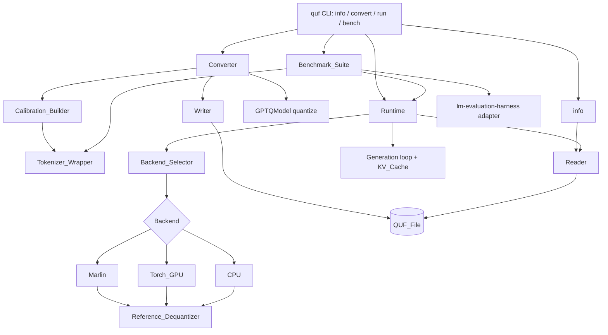
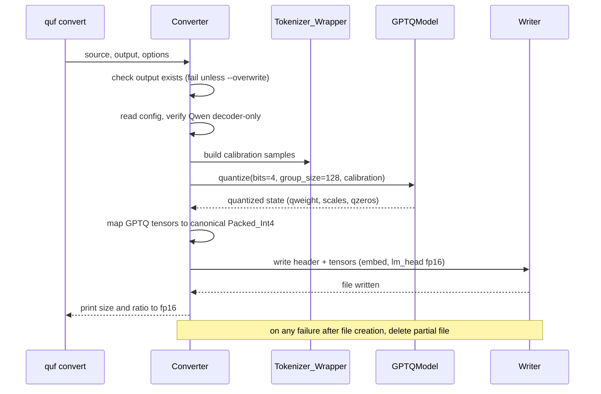
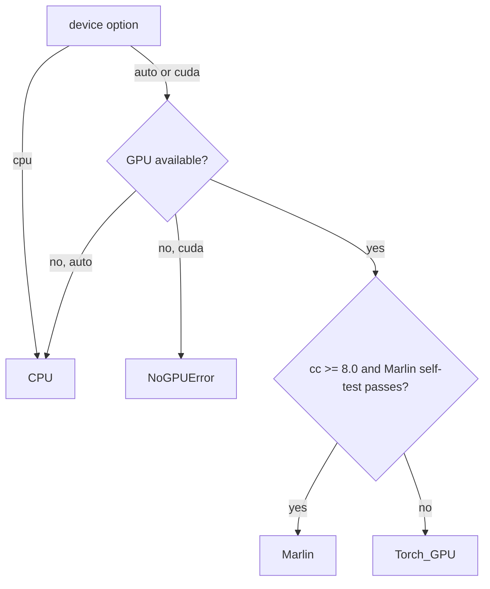
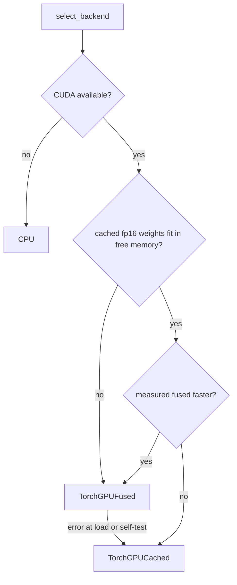

# Design Document

## Overview

QUF is a Python package `quf` that defines a single-file format for 4-bit quantized decoder-only LLMs (v1 target: Qwen, group size 128), plus a converter and an inference runtime. The design splits responsibilities this way:

- **QUF owns** the file format (writer, reader, validation), the reference quantizer/packer/dequantizer, the CLI, the backend selection, and the generation loop.
- **GPTQModel owns** calibrated quantization (GPTQ) and the Marlin and CPU kernels. QUF does not write its own GPU kernels.
- **Gigatoken** tokenizes calibration, evaluation and batch data. Hugging Face `tokenizers` is the fallback.
- **lm-evaluation-harness** drives accuracy evaluation through an adapter.

Key design decisions:

| Decision | Rationale |
|---|---|
| Canonical on-disk weight layout is plain GPTQ-style Packed_Int4 (8 nibbles per int32), not Marlin layout | Keeps the file kernel-independent. Marlin repacking happens at load time, so the file stays valid if kernels change. |
| The pure-PyTorch Reference_Dequantizer is the single source of truth | Every backend is tested against it. It also is the Torch_GPU backend, which is the safe fallback if Marlin fails on Blackwell (sm_120). |
| JSON header with a binary tensor region aligned to 64 bytes | Human-inspectable, extensible, and the tensor region is directly `mmap`-able. |
| Backend selection is a pure function | It can be property-tested without a GPU. |
| Optional dependencies are imported lazily | `import quf` and the CPU test suite work with no extras (Requirements 1.5, 13.5). |

Research findings that inform the design (sources are the project documentation, to be confirmed by the Environment_Spike in docs/ENV.md):

- GPTQModel exposes quantization with a calibration dataset and a Marlin kernel path requiring compute capability 8.0 or higher ([GPTQModel repository](https://github.com/ModelCloud/GPTQModel)). Whether the prebuilt Marlin kernel runs on sm_120 (RTX 5080) is unverified, so the design treats it as optional and gates it with a runtime self-test.
- The GGUF format (magic, version, metadata, aligned tensor data) is the structural model for the QUF layout ([GGUF spec](https://github.com/ggml-org/ggml/blob/master/docs/gguf.md)). QUF uses a JSON header instead of binary key/value metadata for simplicity.
- Blackwell GPUs need a PyTorch build with CUDA 12.8 or later. The spike records the exact build.

## Architecture



### Windows / WSL split

| Component | Windows (native) | WSL Ubuntu + CUDA |
|---|---|---|
| Format, Reader, Writer, Quantizer, Reference_Dequantizer, CLI `info` | Yes | Yes |
| CPU Backend (reference path) and CPU test suite | Yes | Yes |
| Torch_GPU Backend | Yes, if PyTorch CUDA build supports sm_120 | Yes |
| Marlin Backend (GPTQModel kernels) | Only if GPTQModel builds on Windows. Not assumed. | Primary target |
| `quf convert` (GPTQModel quantization) | Not assumed | Primary target |
| gigatoken | Verified by spike. Falls back to HF `tokenizers` | Yes |

A QUF_File is portable between the two environments. Conversion runs in WSL, and the resulting file can run on Windows via CPU or Torch_GPU. The Environment_Spike writes the outcome to docs/ENV.md, and Backend_Selector reads capability at runtime instead of hard-coding the OS.

### Module structure

```
quf/
  __init__.py          # __version__, lazy optional imports
  device.py            # detect_devices() -> DeviceInfo
  format/
    constants.py       # MAGIC, VERSION, ALIGN=64, dtype codes
    writer.py          # write_quf(path, header, tensors)
    reader.py          # QUFReader, QUFFormatError subclasses
    schema.py          # header dataclasses + JSON (de)serialization
  quant/
    pack.py            # pack_int4 / unpack_int4
    quantize.py        # quantize_groupwise (reference RTN), GroupSizeError
    dequant.py         # reference_dequantize
  tokenization/
    wrapper.py         # TokenizerWrapper (gigatoken, HF fallback)
    calibration.py     # build_calibration
  convert/
    converter.py       # convert_checkpoint
    gptq.py            # GPTQModel invocation + tensor extraction
  runtime/
    backends/
      base.py          # LinearBackend protocol
      cpu.py, torch_gpu.py, marlin.py
    selector.py        # select_backend (pure)
    linear.py          # QUFLinear
    model.py           # Qwen decoder, KV_Cache
    generate.py        # sampling + generation loop
  bench/
    suite.py           # perplexity, size, speed, results JSON
    lm_eval_adapter.py
  cli.py
docs/ENV.md
FORMAT.md
tests/                 # CPU tests plus gpu-marked tests
```

## Components and Interfaces

### Device detection (`quf.device`)

```python
@dataclass(frozen=True)
class DeviceInfo:
    cuda_available: bool
    name: str | None
    compute_capability: tuple[int, int] | None
    total_memory_bytes: int | None

def detect_devices() -> DeviceInfo: ...
```

`torch` is imported inside the function. If torch is missing or reports no CUDA, the function returns `DeviceInfo(False, None, None, None)` and does not raise.

### Format layer

```python
class QUFFormatError(Exception): ...
class InvalidMagicError(QUFFormatError): ...
class UnsupportedVersionError(QUFFormatError): ...   # carries file_version, supported_version
class TruncatedHeaderError(QUFFormatError): ...
class TensorBoundsError(QUFFormatError): ...         # carries tensor name
class HeaderSchemaError(QUFFormatError): ...         # invalid JSON or missing field

def write_quf(path, header: QUFHeader, tensors: Mapping[str, np.ndarray]) -> None: ...

class QUFReader:
    header: QUFHeader
    def __init__(self, path): ...        # validates, mmaps the file
    def tensor(self, name: str) -> np.ndarray: ...   # zero-copy view
    def tensor_names(self) -> list[str]: ...
    def close(self): ...
```

The writer computes offsets (each rounded up to a multiple of 64), writes the header, pads, then writes tensor bytes. The Reader validates in a fixed order: magic, version, header length, JSON parse, required fields, per-tensor offset alignment and bounds.

### Quantization layer

```python
def pack_int4(values: np.ndarray) -> np.ndarray:    # uint8 [..., N] (N%8==0) -> int32 [..., N//8]
def unpack_int4(packed: np.ndarray) -> np.ndarray:
def quantize_groupwise(w: Tensor, group_size=128, symmetric=False) -> QuantizedWeight: ...
def reference_dequantize(qw: QuantizedWeight) -> Tensor:  # fp16, original shape
```

`quantize_groupwise` is a deterministic round-to-nearest reference used for kernel verification and format tests. Calibrated GPTQ weights come from GPTQModel and use the same packed representation.

### Tokenization and calibration

```python
class TokenizerWrapper:
    def __init__(self, model_id_or_path): ...   # tries gigatoken, logs reason on fallback
    def encode(self, text: str) -> list[int]
    def decode(self, ids: list[int]) -> str

def build_calibration(texts: Iterable[str], tok: TokenizerWrapper,
                      n_samples: int, seq_len: int, seed: int) -> list[list[int]]
```

`build_calibration` concatenates tokenized text, shuffles document order with `random.Random(seed)`, and slices non-overlapping windows of `seq_len`. If the available tokens are fewer than `n_samples * seq_len`, it raises `CalibrationShortfallError` with the shortfall.

### Converter

```python
def convert_checkpoint(source: str, output: Path, *, dataset, n_samples, seq_len,
                       seed, overwrite=False) -> ConvertResult   # size_bytes, ratio
```

Flow:



The converter writes to the final path only after the existence check. It wraps the write in `try/except`, removing the partial file on failure and re-raising. Architecture is checked from `config.architectures` against an allow-list (`Qwen2ForCausalLM`, extensible to `Qwen3ForCausalLM`), before any heavy work.

### Backends and selection

```python
class LinearBackend(Protocol):
    name: str
    def prepare(self, qw: QuantizedWeight, device) -> object: ...   # repack at load time
    def matmul(self, x: Tensor, prepared) -> Tensor: ...

class BackendChoice(NamedTuple):
    backend: Literal["marlin", "torch_gpu", "cpu"]
    reason: str

def select_backend(device_option: Literal["auto","cpu","cuda"],
                   info: DeviceInfo,
                   marlin_self_test: Callable[[], bool]) -> BackendChoice:
    # raises NoGPUError when option == "cuda" and not info.cuda_available
```

Selection rules:



The self-test is a small Marlin matmul compared with the reference result. It is only called when cc >= 8.0 and a GPU is present, and a raised exception counts as failure. The selector logs `choice.backend` and `choice.reason`.

`QUFLinear` holds the prepared weight for one backend and exposes `forward(x)`. The `prepare` step of Marlin repacks canonical Packed_Int4 in memory only; the file is opened read-only through mmap. If CUDA allocation fails during load, the runtime catches the out-of-memory error and exits with required versus available bytes (required is the sum of tensor byte sizes in the Tensor_Table plus KV_Cache estimate).

### Runtime and generation

```python
class KVCache:
    def append(self, layer: int, k: Tensor, v: Tensor) -> None
    def get(self, layer: int) -> tuple[Tensor, Tensor]
    length: int

class QUFModel:
    @classmethod
    def load(cls, path, device_option) -> "QUFModel"
    def forward(self, ids: Tensor, cache: KVCache | None) -> Tensor   # logits

def generate(model, tok, prompt, *, max_new_tokens, temperature, top_k, top_p, seed,
             stream: Callable[[str], None] | None) -> list[int]
```

The decoder implements Qwen2 (RMSNorm, rotary embeddings, grouped-query attention, SwiGLU MLP) with all projection matmuls going through `QUFLinear`. `generate` checks `len(prompt_ids) + max_new_tokens <= header.model_config.max_position_embeddings` and otherwise raises `ContextLengthError(prompt_len, max_new, context_len)`. Sampling uses a `torch.Generator` seeded per call. Temperature 0 uses `argmax`. Generation stops at the EOS token id from the Header tokenizer info.

### Benchmarks

```python
def perplexity(model, tok, dataset="wikitext-2-raw-v1", ctx_len=2048) -> float
def run_bench(quf_path, *, fp16_ref=None, gguf=None, out_json) -> BenchResult
```

`BenchResult` is serialized to JSON with `backend`, `device_name`, `software_versions`, `perplexity`, `file_size_bytes`, `tokens_per_second`, and optional `fp16_perplexity`, `relative_ppl_increase`, `gguf_size_bytes`, `gguf_tokens_per_second`. The 3 percent target is documented in the README and reported next to the measured value, but is not asserted by automated tests. `lm_eval_adapter.py` subclasses the harness `LM` base class and implements `loglikelihood`, `loglikelihood_rolling`, and `generate_until` on top of `QUFModel`. Dataset load failure raises `DatasetLoadError(dataset_name)`.

### CLI

`argparse` with subparsers `info`, `convert`, `run`, `bench`. Common option `--device {auto,cpu,cuda}` on `run` and `bench`. `main(argv) -> int` returns the exit status so it can be tested directly. Unknown subcommands print the valid list and return a nonzero status (argparse exit code 2). Format, context, and dataset errors are caught at the CLI boundary, printed to stderr, and mapped to exit status 1.

## Data Models

### QUF v1 byte layout

All integers are little-endian.

```
Offset  Size   Field
0       4      magic = "QUF1" (0x51 0x55 0x46 0x31)
4       4      version (uint32) = 1
8       8      header_len (uint64), byte length of the JSON header
16      N      header: UTF-8 JSON, N = header_len
16+N    pad    zero bytes up to the next multiple of 64 (tensor_data_start)
...     ...    tensor data region; each tensor starts at a multiple of 64
                (offsets in the Tensor_Table are absolute file offsets)
```

Every tensor offset is an absolute file offset and a multiple of 64. Gaps between tensors are zero padding.

### Header JSON

```json
{
  "model_config": { "architecture": "Qwen2ForCausalLM", "hidden_size": 896,
    "num_hidden_layers": 24, "num_attention_heads": 14, "num_key_value_heads": 2,
    "intermediate_size": 4864, "vocab_size": 151936, "max_position_embeddings": 32768,
    "rms_norm_eps": 1e-6, "rope_theta": 1000000.0, "tie_word_embeddings": true },
  "tokenizer": { "model_id": "Qwen/Qwen2.5-0.5B", "eos_token_id": 151643,
    "bos_token_id": null, "files": { "tokenizer.json": "<embedded string or tensor name>" } },
  "quantization": { "method": "gptq", "bits": 4, "group_size": 128,
    "symmetric": false, "pack_dtype": "int32", "pack_order": "lsb_first" },
  "tensors": [
    { "name": "model.layers.0.self_attn.q_proj.qweight", "dtype": "int32",
      "shape": [112, 896], "offset": 4096 }
  ]
}
```

Required top-level fields: `model_config`, `tokenizer`, `quantization`, `tensors`. Required Tensor_Table entry fields: `name`, `dtype`, `shape`, `offset`. Dtypes: `fp16`, `fp32`, `int32`. The byte size of a tensor is computed from dtype and shape.

### Quantized tensors per linear layer

For a linear layer with weight shape `[out, in]` and `in % 128 == 0`:

| Tensor | dtype | shape | Notes |
|---|---|---|---|
| `<name>.qweight` | int32 | `[in/8, out]` | 8 four-bit values per int32 along the input dimension, value `i` in bits `4*(i%8)` (least significant first) |
| `<name>.scales` | fp16 | `[in/128, out]` | one per group |
| `<name>.qzeros` | int32 | `[in/128, out/8]` | present only when `symmetric` is false |

Embedding (`model.embed_tokens.weight`), `lm_head.weight` (when untied), and norm weights are fp16. Dequantization is `w = (q - zero) * scale` with `zero = 8` for symmetric schemes.

### In-memory types

```python
@dataclass
class QuantizedWeight:
    qweight: Tensor  # int32 packed
    scales: Tensor   # fp16
    qzeros: Tensor | None
    group_size: int  # 128
    in_features: int
    out_features: int

@dataclass
class QUFHeader:
    model_config: dict
    tokenizer: dict
    quantization: dict
    tensors: list[TensorEntry]   # name, dtype, shape, offset
```

## Correctness Properties

*A property is a characteristic or behavior that should hold true across all valid executions of a system-essentially, a formal statement about what the system should do. Properties serve as the bridge between human-readable specifications and machine-verifiable correctness guarantees.*

Reflection notes: requirement 4.1 is subsumed by the round trip (Property 2). Requirements 3.1 to 3.7 and 7.3, 7.4 merge into the layout invariant (Property 1). Requirements 5.1 and 5.4 merge into Property 5. Requirement 8.3 is covered by Property 11. Requirements 10.2 to 10.7 merge into Property 14. Requirements 9.2 and 9.4 merge into Property 10.

### Property 1: Written file layout invariant

For any valid set of tensors and header inputs (including arbitrary tensor sizes), the bytes produced by the Writer begin with `QUF1`, the version, and the correct header length; the header JSON contains `model_config`, `tokenizer`, `quantization` with group size 128, and a Tensor_Table entry (name, dtype, shape, offset) for every tensor; every offset is a multiple of 64; and embedding and lm_head tensors have dtype fp16.

**Validates: Requirements 3.1, 3.2, 3.3, 3.4, 3.6, 3.7, 7.3, 7.4**

### Property 2: Write/read round trip

For any valid in-memory model, writing it to a QUF_File and reading it back produces an equivalent Header and bit-identical tensors.

**Validates: Requirements 3.5, 4.1, 4.7**

### Property 3: Reader rejects corrupted files

For any valid QUF_File and any single corruption chosen from {wrong magic, version greater than supported, header length past end of file, tensor offset not a multiple of 64, tensor offset plus size past end of file, invalid JSON, missing required field}, the Reader raises the error type that corresponds to that corruption, and the message for offset errors names the affected tensor.

**Validates: Requirements 4.2, 4.3, 4.4, 4.5, 4.6**

### Property 4: Pack/unpack round trip

For any array of values in 0..15 whose length is a multiple of 8, unpacking after packing returns the original array.

**Validates: Requirements 5.2, 5.3**

### Property 5: Quantizer output shape and range

For any weight matrix whose input dimension is a multiple of 128, the Quantizer produces integer values in 0..15, one fp16 scale per group (and zero points when asymmetric), and the Reference_Dequantizer returns an fp16 matrix of the original shape.

**Validates: Requirements 5.1, 5.4**

### Property 6: Quantization error bound

For any weight matrix with input dimension a multiple of 128, the absolute difference between each dequantized element and the original element is at most half of its group scale plus fp16 rounding error.

**Validates: Requirements 5.5**

### Property 7: Group-size violations rejected

For any weight matrix whose input dimension is not a multiple of 128, the Quantizer raises an error that states the dimension and the group size.

**Validates: Requirements 5.6**

### Property 8: Tokenizer round trip

For any text string, decoding the ids returned by encoding reproduces the original text.

**Validates: Requirements 6.3**

### Property 9: Calibration shape, determinism, and shortfall

For any dataset, sample count, sequence length, and seed, the Calibration_Builder returns exactly the requested number of samples of exactly the requested length, returns identical samples when called twice with the same inputs, and raises an error stating the shortfall when the dataset has too few tokens.

**Validates: Requirements 6.4, 6.5, 6.6**

### Property 10: Backend output matches the reference

For any quantized weight and input activation, the QUFLinear output on each available Backend (CPU, Torch_GPU, Marlin) is within an absolute tolerance of 1e-2 in fp16 of the matrix multiply of the input with the Reference_Dequantizer weights. GPU Backends are skipped when no NVIDIA GPU is available.

**Validates: Requirements 8.2, 9.2, 9.4**

### Property 11: KV_Cache equivalence

For any prompt and continuation, the logits computed incrementally with the KV_Cache equal the logits from recomputing the full sequence without the cache, within an absolute tolerance of 1e-2.

**Validates: Requirements 8.3, 8.10**

### Property 12: Sampling determinism and greedy decoding

For any model, prompt, and option set, two runs with the same seed produce identical token ids on the same Backend, and with temperature 0 each generated token is the highest-probability token at its step.

**Validates: Requirements 8.6, 8.7**

### Property 13: Context length check

For any prompt length and maximum new tokens, generation is rejected with an error stating both numbers if and only if their sum exceeds the context length in the Header.

**Validates: Requirements 8.8**

### Property 14: Backend selection rules

For any device option, DeviceInfo, and Marlin self-test result, the Backend_Selector returns Marlin when the option is `auto` or `cuda`, a GPU is available, its compute capability is at least 8.0, and the self-test passes; returns Torch_GPU when the option is `auto` or `cuda`, a GPU is available, and Marlin is not selected; returns CPU when the option is `cpu` or when the option is `auto` with no GPU; and raises an error stating that no NVIDIA GPU was found when the option is `cuda` with no GPU.

**Validates: Requirements 10.2, 10.3, 10.4, 10.5, 10.6, 10.7**

### Property 15: Existing output is preserved

For any existing file content at the output path and no overwrite option, the Converter exits with a nonzero status and the existing file bytes are unchanged.

**Validates: Requirements 7.7**

### Property 16: Info output completeness

For any valid QUF_File, the output of `quf info` contains the model config, the quantization scheme, the tensor count, and the total file size.

**Validates: Requirements 12.2**

### Property 17: Benchmark results JSON round trip

For any benchmark result, serializing to JSON and parsing returns an equivalent result containing the Backend, device name, and software versions.

**Validates: Requirements 11.6**

## Error Handling

| Condition | Error | Surface |
|---|---|---|
| Bad magic, unsupported version, truncated header, bad tensor offset/bounds, bad JSON/missing field | Subclasses of `QUFFormatError` with specific messages (Requirements 4.2 to 4.6) | CLI prints message, exit 1 |
| Input dimension not a multiple of 128 | `GroupSizeError(dim, group_size)` | Raised from Quantizer, converter exits 1 |
| Calibration data too small | `CalibrationShortfallError(needed, available)` | Converter exits 1 |
| Non-Qwen architecture | `UnsupportedArchitectureError(name)` | Converter exits 1 before heavy work |
| Output path exists, no overwrite | `OutputExistsError` | Exit 1, file untouched |
| Failure after output file created | Converter deletes the partial file and re-raises | Exit 1 |
| Prompt plus new tokens exceeds context | `ContextLengthError(prompt_len, max_new, context_len)` | Exit 1 |
| `--device cuda` with no GPU | `NoGPUError("no NVIDIA GPU was found")` | Exit 1 |
| CUDA out of memory at load | `GPUMemoryError(required, available)` | Exit 1 |
| Marlin self-test fails or raises | Logged, Torch_GPU selected | Warning only |
| gigatoken import failure | Logged reason, HF `tokenizers` used | Warning only |
| WikiText dataset load failure | `DatasetLoadError(name)` | Exit 1 |
| Optional extra missing when a feature needs it | Error naming the extra to install (`quf[cuda]` or `quf[convert]`) | Exit 1 |

## Testing Strategy

**Dual approach.** Property-based tests cover universal behavior of the pure logic: format, packing, quantization, calibration, selection, and numerical equivalence of backends. Example-based unit and integration tests cover the CLI, error messages, I/O orchestration, and anything touching external libraries.

**Property-based testing library:** Hypothesis (Python). Each correctness property above is implemented as a single Hypothesis test configured with `max_examples >= 100` (a shared profile in `conftest.py`). Each test carries a comment tag in the form `Feature: quf-quantized-format, Property N: <property text>`. Numerical tests use small shapes (for example `in` of 128 to 512, `out` of 8 to 64) and PyTorch CPU for speed. Properties 8 and 12 use tiny fixture tokenizers/models built in memory.

**Example and unit tests:**

- Package: `quf.__version__` exists, extras declared in `pyproject.toml`, import works with extras absent (Requirements 1.1, 1.2, 1.5).
- Device detection with mocked `torch.cuda` for the GPU and no-GPU cases (1.3, 1.4).
- Tokenizer fallback with gigatoken import mocked to fail, asserting the log message (6.2).
- Converter: size and ratio printed (7.5), non-Qwen rejection (7.6), partial-file cleanup with an injected failure (7.8), using a stubbed GPTQModel.
- Runtime: end-to-end `quf run` on a tiny random Qwen-shaped QUF_File (8.1), streaming (8.4), option parsing (8.5), EOS stop (8.9), file hash unchanged after load (9.5), GPU OOM message with a mocked allocator (9.6).
- Selector logging (10.8), CLI `--device` values (10.1), subcommands, `--help`, unknown subcommand (12.1, 12.4, 12.5), `info` on a corrupt file (12.3).
- Benchmark: dataset failure (11.7), fields reported with a stub model (11.1 to 11.3).

**Integration tests (marked, not run in CI):**

- `gpu` marker: Marlin and Torch_GPU equivalence (Property 10 GPU variants), Marlin repack at load (9.1), skipped when no NVIDIA GPU is present (13.6).
- `convert` marker: real GPTQModel conversion of Qwen2.5-0.5B in WSL (7.1, 7.2), and the lm-evaluation-harness adapter smoke test (11.5).
- Accuracy and speed runs on Qwen2.5-0.5B, 1.5B, and 7B are manual benchmark runs documented in the README. The 3 percent perplexity target is reported, not asserted.

**CI:** builds a wheel and runs `pytest -m "not gpu and not convert"` on CPU runners with no NVIDIA GPU (13.4, 13.5).

**Not covered by automated tests:** the Environment_Spike (Requirement 2), documentation files (3.8, 13.2, 13.3), and tokenization using gigatoken itself (6.1), which is verified manually and recorded in docs/ENV.md.

## Windows-Native Extension Design

This section extends the design for Requirements 14 to 17. It supersedes the WSL split and the GPTQModel and Marlin choices above. Everything runs on native Windows with PyTorch only.

### Native GPTQ (`quf/quant/gptq.py`)

```python
def gptq_quantize(weight: Tensor, hessian: Tensor, *, group_size: int = 128,
                  symmetric: bool = False, damp: float = 0.01,
                  block_size: int = 128) -> QuantizedWeight: ...

class HessianAccumulator:
    def __init__(self, in_features: int, device): ...
    def add_batch(self, x: Tensor) -> None: ...   # H = (n/(n+m)) H + (2/(n+m)) X^T X
    @property
    def hessian(self) -> Tensor: ...

def quantize_model_sequential(model, calib: Tensor, *, symmetric: bool, device) -> dict[str, QuantizedWeight]: ...
```

The algorithm follows the published GPTQ procedure ([GPTQ paper](https://arxiv.org/abs/2210.17323)): damp the Hessian diagonal by `damp * mean(diag(H))`, compute the upper Cholesky factor of H inverse, then quantize columns in blocks of 128 and propagate the rounding error to the remaining columns. Act-order is off. Scales and zero points are computed per group of 128 input columns from the current, error-updated weights when the group starts. Dead columns (zero Hessian diagonal) get diagonal 1 and weight 0. If Cholesky fails, damping is multiplied by 10 for up to 5 retries, then `GPTQError(layer)` is raised.

The output is a `QuantizedWeight` packed with `pack_int4`, so it is byte-compatible with `quantize_groupwise`.

`quantize_model_sequential` moves one decoder layer at a time to the device, captures its input activations with a hook on the first layer, registers forward hooks on each linear to fill a `HessianAccumulator`, runs the calibration batches, quantizes the linears in sequence groups (attention q, k, v; o; gate, up; down), then recomputes the layer outputs with the quantized layer, which become the next layer's inputs. Device is CUDA when `torch.cuda.is_available()`, else CPU. `quf/convert/converter.py` calls this instead of GPTQModel, loading the model with `transformers.AutoModelForCausalLM` and calibration from `build_calibration`. The `quf/convert/gptq.py` GPTQModel path is removed, and the `convert` extra lists `transformers`, `datasets`, `accelerate`, and `gigatoken`.

### Windows-native GPU backends

Triton and custom CUDA kernels are not assumed to install on Windows. Two Backends are implemented in pure PyTorch:

| Backend | Weight storage on GPU | Per-call work |
|---|---|---|
| `TorchGPUCached` (existing Torch_GPU behavior) | fp16 dequantized weight cached at load | one `F.linear` |
| `TorchGPUFused` (new) | packed int32, fp16 scales and zeros | unpack, dequantize, and `F.linear` in one function, optionally wrapped in `torch.compile` |

`TorchGPUFused` uses 4x less GPU memory for weights, which matters for large models. A fused path using `torch.compile` can only be faster if the compiler generates a fused kernel, which needs a working Triton install (not guaranteed on Windows). The decision is therefore measurement-driven. A script `scripts/bench_backends.py` measures tokens per second for decode (batch 1) on both Backends on the Reference_GPU. `select_backend` prefers the cached backend by default and picks the fused backend only when the recorded measurement shows it faster, or when the device memory cannot hold the cached fp16 weights (the memory estimate is compared with free memory). The selector keeps its pure-function signature and takes the memory estimate and an optional `prefer_fused` flag as inputs. Marlin code stays as an optional module that is imported lazily, is not in any extra, and is never selected unless the user passes `--backend marlin`.



### Verification and results

`scripts/verify_real_model.py` converts Qwen/Qwen2.5-0.5B, runs `quf run` on CPU and CUDA with a fixed prompt and seed, and runs `quf bench` for WikiText-2 perplexity, file size, and tokens per second, including the fp16 reference. Output goes to `docs/RESULTS.md` and the README results table. gigatoken installation on Windows is tested and the outcome, or the fallback, is documented in docs/ENV.md and docs/RESULTS.md. Qwen2.5-1.5B repeats the run if time permits.

### Packaging

`pyproject.toml` moves `torch` to base `dependencies`, sets `license = "MIT"` with `license-files = ["LICENSE"]`, `authors = [{name = "vtrsharvin-sj"}]`, `[project.urls]` with Homepage and Repository set to https://github.com/vtrsharvin-sj/Quantized-Model-Format, and classifiers (Python versions, MIT, Windows, Linux, Scientific/Engineering AI). The `cuda` extra is removed or left empty, and the `convert` extra loses GPTQModel. `python -m build` produces the sdist and wheel, `twine check dist/*` validates them, and a fresh venv installs the wheel for a smoke test. No upload happens in a task.

### Extension error handling

| Condition | Behavior | Outcome |
|---|---|---|
| Hessian not positive definite | Damping x10, retry up to 5 times, then `GPTQError(layer)` | Converter exits 1 |
| Fused backend load or self-test failure | Logged, cached backend selected | Warning only |
| `--backend marlin` without GPTQModel installed | Error naming the optional package | Exit 1 |
| torch missing at runtime | Not possible after the base dependency change | None |

## Extension Correctness Properties

### Property 18: GPTQ error is no worse than round-to-nearest

For any small random weight matrix with input dimension a multiple of 128, any calibration activations, and either scheme (symmetric or asymmetric), the squared output error on the calibration data of the Native_GPTQ result is less than or equal to that of round-to-nearest quantization with the same scheme, within a relative tolerance of 1e-3.

**Validates: Requirements 14.7**

### Property 19: GPTQ output shape, range, and layout

For any weight matrix with input dimension a multiple of 128 and any calibration activations, the Native_GPTQ output unpacks to integer values in 0 to 15, has fp16 scales of shape `[in/128, out]`, has zero points only for the asymmetric scheme, and reference-dequantizes to a matrix of the original shape.

**Validates: Requirements 14.1, 14.2, 14.8**

### Property 20: Fused backend matches the reference

For any quantized weight and input activation, the `TorchGPUFused` output (eager and compiled when available) is within an absolute tolerance of 1e-2 in fp16 of the multiplication with Reference_Dequantizer weights, and equals the `TorchGPUCached` output within the same tolerance.

**Validates: Requirements 15.2, 15.3, 15.6**

### Property 21: Extended backend selection rules

For any combination of CUDA availability, free memory estimate, measured fused speed advantage, and self-test result, `select_backend` returns CPU when CUDA is unavailable, the fused backend when cached weights do not fit or the fused path is measured faster and its self-test passes, and the cached backend otherwise, and never returns Marlin unless explicitly requested.

**Validates: Requirements 15.1, 15.4, 15.5, 15.7**

## Extension Testing Strategy

Property tests use Hypothesis with at least 100 examples and the tag `Feature: quf-quantized-format, Property N: <property text>`. Properties 18 and 19 use small shapes (in of 128 to 256, out of 8 to 32, 64 to 256 calibration rows) on CPU. Property 20 runs on CPU for the eager variant and is also marked `gpu` for CUDA. Property 21 is a pure function test.

Unit and integration tests cover the Hessian accumulator against a direct `2 X^T X / n` computation, the Cholesky retry path with a rank-deficient Hessian, sequential quantization of a tiny random Qwen-shaped model, the converter producing a file that `quf info` reads, and the pyproject metadata fields. Real-model runs (task 12) and the wheel smoke test (task 13) are manual verification scripts, marked `convert` or `gpu`, and excluded from CI. CI-run tests continue to use `pytest -m "not gpu and not convert"`.

## Accuracy Upgrade Design (release 0.2.0)

### Approach

The 0.1.0 result is 14.04 to 14.18 perplexity against 13.07 for fp16. The design is diagnosis first, then upgrades, then keep only what the measurements support. Each Upgrade is a flag with a conservative default, and the defaults are set in task 16.8 from the measured perplexity. 4-bit weights cannot beat fp16 perplexity, so the 3 percent target is reported as reached or not reached from the data.

### Diagnosis (`quf/analysis/sensitivity.py`)

```python
@dataclass
class ModuleError:
    name: str            # e.g. model.layers.3.mlp.down_proj
    layer: int
    kind: str            # q_proj, k_proj, v_proj, o_proj, gate_proj, up_proj, down_proj
    rel_output_error: float   # ||X W^T - X Wq^T||_F / ||X W^T||_F on calibration data

def module_errors(model, calib, scheme) -> list[ModuleError]: ...
def ablate(model, tok, quantize_names: set[str], scheme, eval_cfg) -> float: ...
def standard_subsets(model) -> dict[str, set[str]]: ...  # first, last, v_proj, down_proj, rest
```

`ablate` quantizes the named modules with round-to-nearest or native GPTQ (set by the scheme), leaves all other modules in fp16 in the loaded Hugging Face model, and calls the existing `perplexity` function. `scripts/diagnose_accuracy.py` runs `module_errors` and `ablate` on the standard subsets of Qwen2.5-0.5B and writes the tables to docs/ACCURACY.md. The tied embedding and lm_head weight is reported as fp16 or quantized in the converted file, because Qwen2.5-0.5B ties them.

The `gptq.py` audit checks these items, each with a unit test where the item can be tested:

| Item | Check |
|---|---|
| Hessian accumulation | Streaming accumulator equals `2 X^T X / n` over batches of different sizes, and uses fp32 |
| Damping | `percdamp * mean(diag(H))` added to the diagonal, dead columns handled |
| Calibration data | Token count, sequence length, and text mix reported |
| Sequential order | Layer inputs come from the already quantized preceding layers, and modules within a layer are grouped as in the reference GPTQ true-sequential order |
| fp16 scale rounding | Scales are rounded to fp16 before the error propagation step, so propagated error matches stored weights |
| Tied embeddings | lm_head and embedding stay fp16 and the tie is preserved in the file |

### Format changes

QUF stays one container. Version selection is a pure function of the features used.

| Feature | Header field | Tensors | Version |
|---|---|---|---|
| Group size 128, no g_idx, no int8 | `quantization.group_size = 128` | `qweight`, `scales`, optional `qzeros` | 1 |
| Group size 32 or 64 | `quantization.group_size` | scales shape `[in/gs, out]` | 2 |
| Act-order | `quantization.act_order = true` | `<module>.g_idx`, int32, shape `[in]` | 2 |
| Int8 module | `quantization.modules[<name>] = "int8"` | `<module>.qweight_int8` (dtype `int8`, shape `[out, in]`), `<module>.scales` fp16 `[out]` | 2 |
| fp16 module | `quantization.modules[<name>] = "fp16"` | `<module>.weight` fp16 | 2 |

The Writer computes `required_version(header, tensors)` and writes `QUF1` with that version. The Reader supports versions 1 and 2, and reads a missing `group_size` as 128. Version 1 readers from 0.1.0 reject version 2 files with the existing unsupported-version error, which is the intended behavior. A new dtype code `int8` is added to `constants.py`. The reader validates `group_size in {32, 64, 128}`, `in % group_size == 0`, g_idx values in `[0, in/group_size)`, and the g_idx length.

### Quantizer and dequantizer

- `quantize_groupwise(w, group_size=128, scheme, clip_search=False)` takes the group size and an optional clipping search. The clipping search evaluates ratios `1.0, 0.95, ..., 0.5` (grid in `quf/quant/clip.py`), picks the minimum squared weight error per group, and always includes ratio 1.0 so the result is never worse than round-to-nearest.
- `reference_dequantize(qw, g_idx=None)` gathers scales and zeros by `g_idx[col]` when present, and otherwise by `col // group_size`.
- `quantize_int8(w)` returns int8 values and fp16 per-output-channel scales. `dequantize_int8` returns `q * scale` in fp16.
- `gptq_quantize(..., group_size, act_order, clip_search)` permutes columns by descending Hessian diagonal when `act_order` is set, quantizes in the permuted order with groups formed over permuted columns, and returns the `g_idx` that maps each original column to its group. The weights stay in original column order in storage, so the runtime needs no input permutation. `g_idx` is computed so that column `j` uses group `perm_rank(j) // group_size`.

### Backends

`QUFLinear.prepare` receives the optional `g_idx` and the module precision. The CPU, cached, and fused backends call a shared `expand_groups(scales, zeros, g_idx, group_size, in)` helper that returns per-column scales and zeros, so one code path defines the semantics. The fused backend unpacks, gathers by `g_idx`, scales, and multiplies in one function. Int8 modules use `q.to(fp16) * scale[:, None]`. fp16 modules use a plain matmul. The cached backend caches the dequantized weight as before. Marlin stays unsupported for g_idx and int8 and is only selectable explicitly.

### Mixed precision and size accounting

`PrecisionPlan` maps module-name globs to `int4`, `int8`, or `fp16`, with default `int4`. The Converter takes `--mixed "pattern=precision"` options and reads a plan from docs-selected presets (for example `lm_head`, `*.layers.0.*`, `*.v_proj`) once the diagnosis picks them. `SizeReport` sums bytes from the Tensor_Table by precision class and is printed at conversion and by `quf info`.

### Calibration

`build_calibration` accepts a list of `CalibrationSource(name, loader, share)`. Defaults are wikitext-2 train and a second English text source (the choice is made in task 16.6 and documented). The sample count is split by share, and each source is shuffled with `random.Random(seed + index)`. The defaults become 128 samples of length 2048. If a source is short, the builder raises `CalibrationShortfallError` naming the source and the shortfall. The old 0.1.0 settings remain reachable through `--legacy-calibration` for the comparison runs.

### Evaluation

`scripts/bench_accuracy.py` runs a configuration matrix and writes JSON: fp16, 0.1.0 settings, 0.2.0 defaults, RTN_Baseline, and each single Upgrade added to the 0.1.0 settings. RTN_Baseline uses `quantize_groupwise` through the same Converter path without calibration. GGUF_Baseline uses llama-cpp-python only if `pip install` of a prebuilt wheel succeeds on Windows, and otherwise the script records "not run" with the pip error. lm-evaluation-harness runs on one or two tasks only if already installed or installed with one command. Perplexity uses the existing WikiText-2 procedure and context length so that numbers compare with 0.1.0.

### Upgrade error handling

| Condition | Behavior | Outcome |
|---|---|---|
| Group size not in 32, 64, 128 | `HeaderSchemaError` stating value and supported values | Exit 1 |
| `in % group_size != 0` | `GroupSizeError(in, group_size)` | Converter exits 1 |
| g_idx out of range or wrong length | `TensorBoundsError` naming the tensor | Exit 1 |
| Unknown module precision string | `HeaderSchemaError` naming the module | Exit 1 |
| Mixed plan pattern matches no module | Warning logged | Conversion continues |
| llama-cpp-python missing | Result recorded as not run with the reason | None |

## Accuracy Upgrade Correctness Properties

### Property 22: Ablation changes only the selected modules

For any model and any subset of its linear modules, the Ablation_Harness produces a model in which every module outside the subset has weights bit-identical to the fp16 original and every module in the subset has weights equal to the dequantized quantization of the original.

**Validates: Requirements 18.2**

### Property 23: Header group size and version round trip

For any group size in {32, 64, 128}, any choice of act-order, and any mix of int4, int8, and fp16 modules, writing a QUF_File and reading it returns the same group size, precision map, and bit-identical tensors including g_idx, and the written version is 1 exactly when the group size is 128 and the file has no g_idx and no int8 or fp16 module entries, and 2 otherwise.

**Validates: Requirements 19.1, 19.2, 19.3, 19.4, 20.2, 20.3, 22.1**

### Property 24: Group-size and g_idx validation

For any integer group size outside {32, 64, 128}, any input dimension that is not a multiple of a valid group size, and any g_idx containing a value outside `[0, in/group_size)` or having a length different from `in`, the Reader or Quantizer raises an error whose message states the offending value and, for group sizes, the supported values, and for g_idx names the tensor.

**Validates: Requirements 19.5, 19.6, 20.6**

### Property 25: Backend output matches the reference for all precisions

For any weight, group size in {32, 64, 128}, optional permutation g_idx, precision in {int4, int8, fp16}, and input activation, the CPU, Cached_Dequant_Backend, and Fused_Backend outputs are within an absolute tolerance of 1e-2 in fp16 of the multiplication with Reference_Dequantizer weights, and the Reference_Dequantizer with g_idx equals a direct per-column gather of the group parameters. GPU variants are marked `gpu`.

**Validates: Requirements 20.4, 20.5, 22.3, 22.4**

### Property 26: MSE clipping is no worse than round-to-nearest and keeps the layout

For any weight matrix and group size in {32, 64, 128}, the squared weight error of every group under MSE_Clipping is less than or equal to that of unclipped round-to-nearest with the same scheme, and the output has values in 0 to 15, fp16 scales of shape `[in/group_size, out]`, and the canonical packing.

**Validates: Requirements 21.1, 21.2, 21.4**

### Property 27: Act-order processes columns in descending Hessian diagonal

For any positive semidefinite Hessian, the permutation returned by the act-order step lists columns in non-increasing order of the Hessian diagonal, is a permutation of `0..in-1`, and yields a g_idx in which each group index appears exactly `group_size` times.

**Validates: Requirements 20.1, 20.2**

### Property 28: Size accounting equals tensor bytes

For any precision plan and model shape, the byte totals printed per precision class sum to the total of tensor byte sizes in the Tensor_Table, and each class equals the sum over the tensors that belong to modules of that class.

**Validates: Requirements 22.5, 22.6**

### Property 29: Multi-source calibration shape, shares, and determinism

For any list of sources with shares that sum to 1, any sample count, sequence length, and seed, the Calibration_Builder returns exactly the requested number of samples of exactly the requested length, draws from each source a number of samples that follows the share rounding rule, returns identical samples when called twice, and raises an error naming the source and the shortfall when a source has too few tokens.

**Validates: Requirements 23.2, 23.3, 23.4**

## Accuracy Upgrade Testing Strategy

Property tests use Hypothesis with at least 100 examples and the tag `Feature: quf-quantized-format, Property N: <property text>`. Properties 23 to 28 use small shapes (in of 32 to 256, out of 4 to 32) on CPU, and the GPU variants of Property 25 carry the `gpu` marker. Property 22 and the module error report run on a tiny random Qwen-shaped model. Property 29 uses synthetic token streams.

Unit tests cover the streaming Hessian accumulator, damping and dead columns, fp16 scale rounding in the propagation step, tied embedding handling, a checked-in version 1 fixture written by 0.1.0 that the new Reader must read as group size 128, and the default of 128 samples of length 2048. Real-model steps (diagnosis, upgrade evaluation, 1.5B conversion, GGUF, lm-eval) are scripts run manually and recorded in docs/ACCURACY.md and docs/RESULTS.md. They are excluded from CI. The 3 percent target is reported next to the measured value and is not asserted by tests.

## Verification Extension Design (release 0.2.1)

### GGUF protocol validation

`scripts/bench_accuracy.py` gains a `--protocol {quf,llama}` switch. The llama protocol uses non-overlapping windows of the context length, prepends BOS only as llama.cpp does, and scores only the second half of each window. The GGUF path is checked against `llama-perplexity.exe` (CUDA release if available) on the same text file and context. Suspected causes are BOS handling, batch and context settings, scoring the whole window, and the converted GGUF tokenizer. A Q8_0 or f16 GGUF row serves as the sanity check against fp16. QUF is also evaluated under the llama protocol so both sides share one protocol. Tokens per second are measured on GPU for both llama.cpp and QUF.

### Batched LM_Eval_Adapter

Requests are grouped by shared context, sorted by length, right-padded, and run as one forward pass per batch with an attention mask. Log-likelihoods are gathered from the log-softmax at the continuation positions. Repeated contexts run once, and the continuations are scored from its logits (hellaswag and arc share contexts across choices).

### Decode speed

The benchmark helper does one warm-up, then at least 5 timed repeats, and returns the median. Profiling covers torch_gpu and cpu with g_idx and int8 modules. The Torch_GPU `prepare` step stores an fp16 Weight_Cache for those modules, and a unit test asserts the prepared tensor dtype is float16 and that the forward pass does not call the gather or dequantize path.

### Repository and release

Git is initialised with the existing `.gitignore`, extended where needed. The push step first runs `git ls-remote` and stops if the remote has refs. Credentials come from the user's existing git or gh login. Version 0.2.1 follows the 0.2.0 release steps without upload.

### Error handling

| Condition | Behavior |
|---|---|
| llama-perplexity.exe unavailable | GGUF rows recorded as not run with the reason |
| Remote has commits | Push task stops and reports |
| `pypi-` found in staged files | Commit aborted |

### Testing strategy

Property 30 and the adapter test use Hypothesis with at least 100 examples on a tiny random Qwen-shaped model on CPU, tagged `Feature: quf-quantized-format, Property N: <property text>`. The real-model GGUF, lm-eval, and speed runs are manual scripts excluded from CI.

## Verification Extension Correctness Properties

### Property 30: Batched log-likelihood equals single-request log-likelihood

For any list of (context, continuation) requests, including repeated contexts and mixed lengths, the batched LM_Eval_Adapter returns log-likelihoods within 1e-3 of scoring each request alone.

**Validates: Requirements 27.1, 27.2, 27.3**

### Property 31: Median timing is order-independent

For any list of at least 5 timing samples, the reported tokens per second is the median of the per-repeat values and is unchanged by permuting the samples.

**Validates: Requirements 28.1**
