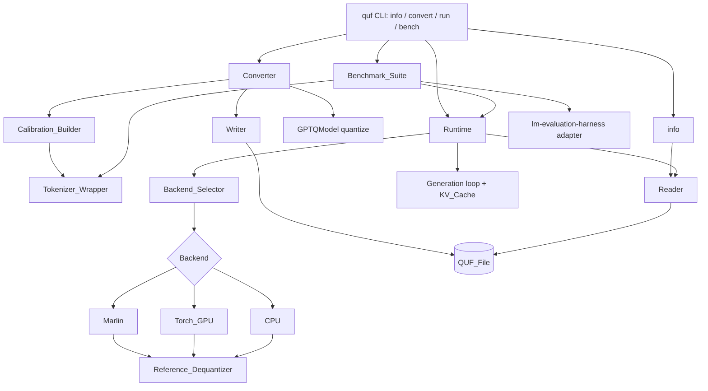
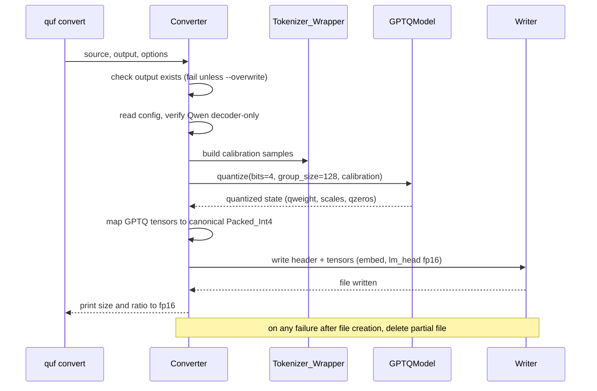
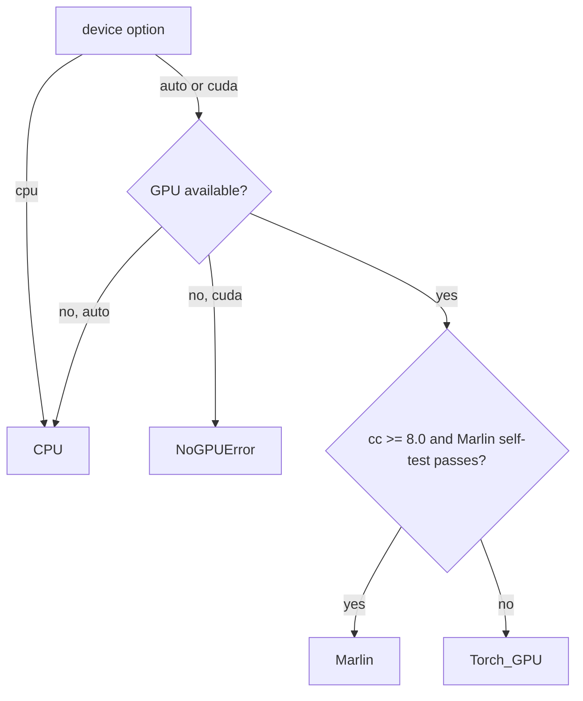
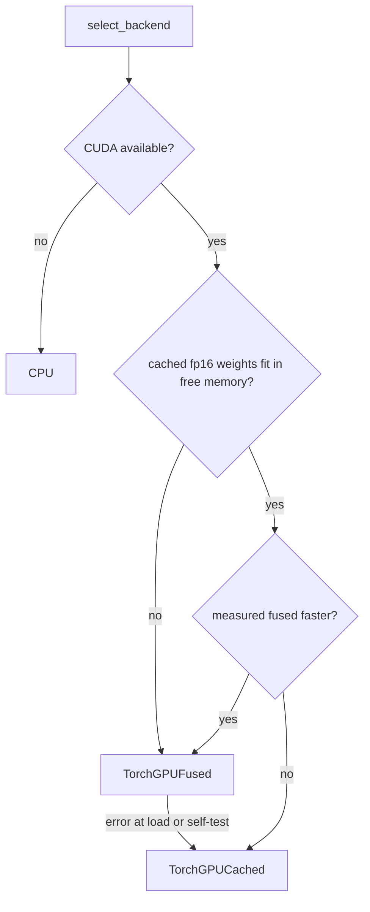
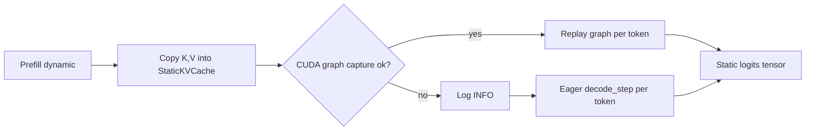
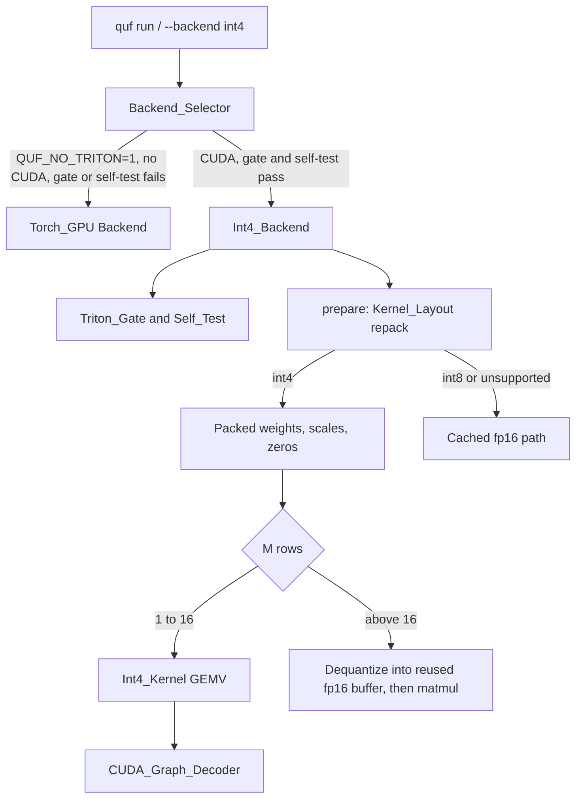
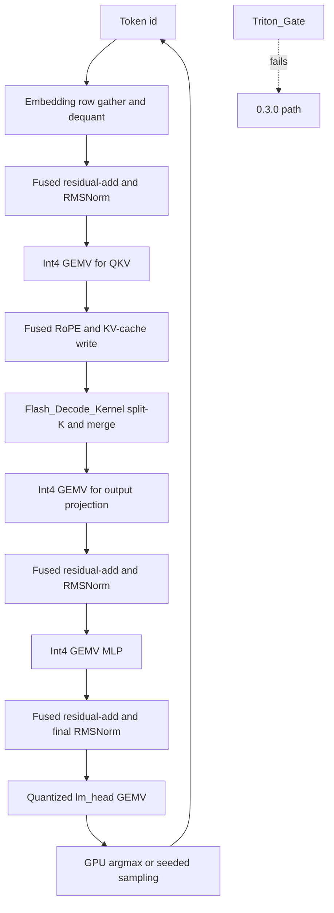
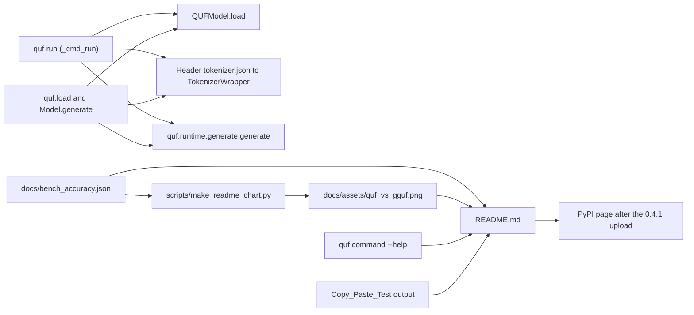

# Design Document

## Overview

QUF is a Python package `quf` that defines a single-file format for 4-bit quantized decoder-only LLMs (v1 target: Qwen, group size 128), plus a converter and an inference runtime. The design splits responsibilities this way:

- **QUF owns** the file format (writer, reader, validation), the reference quantizer/packer/dequantizer, the CLI, the backend selection, and the generation loop.
- **GPTQModel owns** calibrated quantization (GPTQ) and the Marlin and CPU kernels. QUF does not write its own GPU kernels.
- **Gigatoken** tokenizes calibration, evaluation and batch data. Hugging Face `tokenizers` is the fallback.
- **lm-evaluation-harness** drives accuracy evaluation through an adapter.

Key design decisions:

| Decision | Rationale |
|---|---|
| Canonical on-disk weight layout is plain GPTQ-style Packed_Int4 (8 nibbles per int32), not Marlin layout | Keeps the file kernel-independent. Marlin repacking happens at load time, so the file stays valid if kernels change. |
| The pure-PyTorch Reference_Dequantizer is the single source of truth | Every backend is tested against it. It also is the Torch_GPU backend, which is the safe fallback if Marlin fails on Blackwell (sm_120). |
| JSON header with a binary tensor region aligned to 64 bytes | Human-inspectable, extensible, and the tensor region is directly `mmap`-able. |
| Backend selection is a pure function | It can be property-tested without a GPU. |
| Optional dependencies are imported lazily | `import quf` and the CPU test suite work with no extras (Requirements 1.5, 13.5). |

Research findings that inform the design (sources are the project documentation, to be confirmed by the Environment_Spike in docs/ENV.md):

- GPTQModel exposes quantization with a calibration dataset and a Marlin kernel path requiring compute capability 8.0 or higher ([GPTQModel repository](https://github.com/ModelCloud/GPTQModel)). Whether the prebuilt Marlin kernel runs on sm_120 (RTX 5080) is unverified, so the design treats it as optional and gates it with a runtime self-test.
- The GGUF format (magic, version, metadata, aligned tensor data) is the structural model for the QUF layout ([GGUF spec](https://github.com/ggml-org/ggml/blob/master/docs/gguf.md)). QUF uses a JSON header instead of binary key/value metadata for simplicity.
- Blackwell GPUs need a PyTorch build with CUDA 12.8 or later. The spike records the exact build.

## Architecture



### Windows / WSL split

| Component | Windows (native) | WSL Ubuntu + CUDA |
|---|---|---|
| Format, Reader, Writer, Quantizer, Reference_Dequantizer, CLI `info` | Yes | Yes |
| CPU Backend (reference path) and CPU test suite | Yes | Yes |
| Torch_GPU Backend | Yes, if PyTorch CUDA build supports sm_120 | Yes |
| Marlin Backend (GPTQModel kernels) | Only if GPTQModel builds on Windows. Not assumed. | Primary target |
| `quf convert` (GPTQModel quantization) | Not assumed | Primary target |
| gigatoken | Verified by spike. Falls back to HF `tokenizers` | Yes |

A QUF_File is portable between the two environments. Conversion runs in WSL, and the resulting file can run on Windows via CPU or Torch_GPU. The Environment_Spike writes the outcome to docs/ENV.md, and Backend_Selector reads capability at runtime instead of hard-coding the OS.

### Module structure

```
quf/
  __init__.py          # __version__, lazy optional imports
  device.py            # detect_devices() -> DeviceInfo
  format/
    constants.py       # MAGIC, VERSION, ALIGN=64, dtype codes
    writer.py          # write_quf(path, header, tensors)
    reader.py          # QUFReader, QUFFormatError subclasses
    schema.py          # header dataclasses + JSON (de)serialization
  quant/
    pack.py            # pack_int4 / unpack_int4
    quantize.py        # quantize_groupwise (reference RTN), GroupSizeError
    dequant.py         # reference_dequantize
  tokenization/
    wrapper.py         # TokenizerWrapper (gigatoken, HF fallback)
    calibration.py     # build_calibration
  convert/
    converter.py       # convert_checkpoint
    gptq.py            # GPTQModel invocation + tensor extraction
  runtime/
    backends/
      base.py          # LinearBackend protocol
      cpu.py, torch_gpu.py, marlin.py
    selector.py        # select_backend (pure)
    linear.py          # QUFLinear
    model.py           # Qwen decoder, KV_Cache
    generate.py        # sampling + generation loop
  bench/
    suite.py           # perplexity, size, speed, results JSON
    lm_eval_adapter.py
  cli.py
docs/ENV.md
FORMAT.md
tests/                 # CPU tests plus gpu-marked tests
```

## Components and Interfaces

### Device detection (`quf.device`)

```python
@dataclass(frozen=True)
class DeviceInfo:
    cuda_available: bool
    name: str | None
    compute_capability: tuple[int, int] | None
    total_memory_bytes: int | None

def detect_devices() -> DeviceInfo: ...
```

`torch` is imported inside the function. If torch is missing or reports no CUDA, the function returns `DeviceInfo(False, None, None, None)` and does not raise.

### Format layer

```python
class QUFFormatError(Exception): ...
class InvalidMagicError(QUFFormatError): ...
class UnsupportedVersionError(QUFFormatError): ...   # carries file_version, supported_version
class TruncatedHeaderError(QUFFormatError): ...
class TensorBoundsError(QUFFormatError): ...         # carries tensor name
class HeaderSchemaError(QUFFormatError): ...         # invalid JSON or missing field

def write_quf(path, header: QUFHeader, tensors: Mapping[str, np.ndarray]) -> None: ...

class QUFReader:
    header: QUFHeader
    def __init__(self, path): ...        # validates, mmaps the file
    def tensor(self, name: str) -> np.ndarray: ...   # zero-copy view
    def tensor_names(self) -> list[str]: ...
    def close(self): ...
```

The writer computes offsets (each rounded up to a multiple of 64), writes the header, pads, then writes tensor bytes. The Reader validates in a fixed order: magic, version, header length, JSON parse, required fields, per-tensor offset alignment and bounds.

### Quantization layer

```python
def pack_int4(values: np.ndarray) -> np.ndarray:    # uint8 [..., N] (N%8==0) -> int32 [..., N//8]
def unpack_int4(packed: np.ndarray) -> np.ndarray:
def quantize_groupwise(w: Tensor, group_size=128, symmetric=False) -> QuantizedWeight: ...
def reference_dequantize(qw: QuantizedWeight) -> Tensor:  # fp16, original shape
```

`quantize_groupwise` is a deterministic round-to-nearest reference used for kernel verification and format tests. Calibrated GPTQ weights come from GPTQModel and use the same packed representation.

### Tokenization and calibration

```python
class TokenizerWrapper:
    def __init__(self, model_id_or_path): ...   # tries gigatoken, logs reason on fallback
    def encode(self, text: str) -> list[int]
    def decode(self, ids: list[int]) -> str

def build_calibration(texts: Iterable[str], tok: TokenizerWrapper,
                      n_samples: int, seq_len: int, seed: int) -> list[list[int]]
```

`build_calibration` concatenates tokenized text, shuffles document order with `random.Random(seed)`, and slices non-overlapping windows of `seq_len`. If the available tokens are fewer than `n_samples * seq_len`, it raises `CalibrationShortfallError` with the shortfall.

### Converter

```python
def convert_checkpoint(source: str, output: Path, *, dataset, n_samples, seq_len,
                       seed, overwrite=False) -> ConvertResult   # size_bytes, ratio
```

Flow:



The converter writes to the final path only after the existence check. It wraps the write in `try/except`, removing the partial file on failure and re-raising. Architecture is checked from `config.architectures` against an allow-list (`Qwen2ForCausalLM`, extensible to `Qwen3ForCausalLM`), before any heavy work.

### Backends and selection

```python
class LinearBackend(Protocol):
    name: str
    def prepare(self, qw: QuantizedWeight, device) -> object: ...   # repack at load time
    def matmul(self, x: Tensor, prepared) -> Tensor: ...

class BackendChoice(NamedTuple):
    backend: Literal["marlin", "torch_gpu", "cpu"]
    reason: str

def select_backend(device_option: Literal["auto","cpu","cuda"],
                   info: DeviceInfo,
                   marlin_self_test: Callable[[], bool]) -> BackendChoice:
    # raises NoGPUError when option == "cuda" and not info.cuda_available
```

Selection rules:



The self-test is a small Marlin matmul compared with the reference result. It is only called when cc >= 8.0 and a GPU is present, and a raised exception counts as failure. The selector logs `choice.backend` and `choice.reason`.

`QUFLinear` holds the prepared weight for one backend and exposes `forward(x)`. The `prepare` step of Marlin repacks canonical Packed_Int4 in memory only; the file is opened read-only through mmap. If CUDA allocation fails during load, the runtime catches the out-of-memory error and exits with required versus available bytes (required is the sum of tensor byte sizes in the Tensor_Table plus KV_Cache estimate).

### Runtime and generation

```python
class KVCache:
    def append(self, layer: int, k: Tensor, v: Tensor) -> None
    def get(self, layer: int) -> tuple[Tensor, Tensor]
    length: int

class QUFModel:
    @classmethod
    def load(cls, path, device_option) -> "QUFModel"
    def forward(self, ids: Tensor, cache: KVCache | None) -> Tensor   # logits

def generate(model, tok, prompt, *, max_new_tokens, temperature, top_k, top_p, seed,
             stream: Callable[[str], None] | None) -> list[int]
```

The decoder implements Qwen2 (RMSNorm, rotary embeddings, grouped-query attention, SwiGLU MLP) with all projection matmuls going through `QUFLinear`. `generate` checks `len(prompt_ids) + max_new_tokens <= header.model_config.max_position_embeddings` and otherwise raises `ContextLengthError(prompt_len, max_new, context_len)`. Sampling uses a `torch.Generator` seeded per call. Temperature 0 uses `argmax`. Generation stops at the EOS token id from the Header tokenizer info.

### Benchmarks

```python
def perplexity(model, tok, dataset="wikitext-2-raw-v1", ctx_len=2048) -> float
def run_bench(quf_path, *, fp16_ref=None, gguf=None, out_json) -> BenchResult
```

`BenchResult` is serialized to JSON with `backend`, `device_name`, `software_versions`, `perplexity`, `file_size_bytes`, `tokens_per_second`, and optional `fp16_perplexity`, `relative_ppl_increase`, `gguf_size_bytes`, `gguf_tokens_per_second`. The 3 percent target is documented in the README and reported next to the measured value, but is not asserted by automated tests. `lm_eval_adapter.py` subclasses the harness `LM` base class and implements `loglikelihood`, `loglikelihood_rolling`, and `generate_until` on top of `QUFModel`. Dataset load failure raises `DatasetLoadError(dataset_name)`.

### CLI

`argparse` with subparsers `info`, `convert`, `run`, `bench`. Common option `--device {auto,cpu,cuda}` on `run` and `bench`. `main(argv) -> int` returns the exit status so it can be tested directly. Unknown subcommands print the valid list and return a nonzero status (argparse exit code 2). Format, context, and dataset errors are caught at the CLI boundary, printed to stderr, and mapped to exit status 1.

## Data Models

### QUF v1 byte layout

All integers are little-endian.

```
Offset  Size   Field
0       4      magic = "QUF1" (0x51 0x55 0x46 0x31)
4       4      version (uint32) = 1
8       8      header_len (uint64), byte length of the JSON header
16      N      header: UTF-8 JSON, N = header_len
16+N    pad    zero bytes up to the next multiple of 64 (tensor_data_start)
...     ...    tensor data region; each tensor starts at a multiple of 64
                (offsets in the Tensor_Table are absolute file offsets)
```

Every tensor offset is an absolute file offset and a multiple of 64. Gaps between tensors are zero padding.

### Header JSON

```json
{
  "model_config": { "architecture": "Qwen2ForCausalLM", "hidden_size": 896,
    "num_hidden_layers": 24, "num_attention_heads": 14, "num_key_value_heads": 2,
    "intermediate_size": 4864, "vocab_size": 151936, "max_position_embeddings": 32768,
    "rms_norm_eps": 1e-6, "rope_theta": 1000000.0, "tie_word_embeddings": true },
  "tokenizer": { "model_id": "Qwen/Qwen2.5-0.5B", "eos_token_id": 151643,
    "bos_token_id": null, "files": { "tokenizer.json": "<embedded string or tensor name>" } },
  "quantization": { "method": "gptq", "bits": 4, "group_size": 128,
    "symmetric": false, "pack_dtype": "int32", "pack_order": "lsb_first" },
  "tensors": [
    { "name": "model.layers.0.self_attn.q_proj.qweight", "dtype": "int32",
      "shape": [112, 896], "offset": 4096 }
  ]
}
```

Required top-level fields: `model_config`, `tokenizer`, `quantization`, `tensors`. Required Tensor_Table entry fields: `name`, `dtype`, `shape`, `offset`. Dtypes: `fp16`, `fp32`, `int32`. The byte size of a tensor is computed from dtype and shape.

### Quantized tensors per linear layer

For a linear layer with weight shape `[out, in]` and `in % 128 == 0`:

| Tensor | dtype | shape | Notes |
|---|---|---|---|
| `<name>.qweight` | int32 | `[in/8, out]` | 8 four-bit values per int32 along the input dimension, value `i` in bits `4*(i%8)` (least significant first) |
| `<name>.scales` | fp16 | `[in/128, out]` | one per group |
| `<name>.qzeros` | int32 | `[in/128, out/8]` | present only when `symmetric` is false |

Embedding (`model.embed_tokens.weight`), `lm_head.weight` (when untied), and norm weights are fp16. Dequantization is `w = (q - zero) * scale` with `zero = 8` for symmetric schemes.

### In-memory types

```python
@dataclass
class QuantizedWeight:
    qweight: Tensor  # int32 packed
    scales: Tensor   # fp16
    qzeros: Tensor | None
    group_size: int  # 128
    in_features: int
    out_features: int

@dataclass
class QUFHeader:
    model_config: dict
    tokenizer: dict
    quantization: dict
    tensors: list[TensorEntry]   # name, dtype, shape, offset
```

## Correctness Properties

*A property is a characteristic or behavior that should hold true across all valid executions of a system-essentially, a formal statement about what the system should do. Properties serve as the bridge between human-readable specifications and machine-verifiable correctness guarantees.*

Reflection notes: requirement 4.1 is subsumed by the round trip (Property 2). Requirements 3.1 to 3.7 and 7.3, 7.4 merge into the layout invariant (Property 1). Requirements 5.1 and 5.4 merge into Property 5. Requirement 8.3 is covered by Property 11. Requirements 10.2 to 10.7 merge into Property 14. Requirements 9.2 and 9.4 merge into Property 10.

### Property 1: Written file layout invariant

For any valid set of tensors and header inputs (including arbitrary tensor sizes), the bytes produced by the Writer begin with `QUF1`, the version, and the correct header length; the header JSON contains `model_config`, `tokenizer`, `quantization` with group size 128, and a Tensor_Table entry (name, dtype, shape, offset) for every tensor; every offset is a multiple of 64; and embedding and lm_head tensors have dtype fp16.

**Validates: Requirements 3.1, 3.2, 3.3, 3.4, 3.6, 3.7, 7.3, 7.4**

### Property 2: Write/read round trip

For any valid in-memory model, writing it to a QUF_File and reading it back produces an equivalent Header and bit-identical tensors.

**Validates: Requirements 3.5, 4.1, 4.7**

### Property 3: Reader rejects corrupted files

For any valid QUF_File and any single corruption chosen from {wrong magic, version greater than supported, header length past end of file, tensor offset not a multiple of 64, tensor offset plus size past end of file, invalid JSON, missing required field}, the Reader raises the error type that corresponds to that corruption, and the message for offset errors names the affected tensor.

**Validates: Requirements 4.2, 4.3, 4.4, 4.5, 4.6**

### Property 4: Pack/unpack round trip

For any array of values in 0..15 whose length is a multiple of 8, unpacking after packing returns the original array.

**Validates: Requirements 5.2, 5.3**

### Property 5: Quantizer output shape and range

For any weight matrix whose input dimension is a multiple of 128, the Quantizer produces integer values in 0..15, one fp16 scale per group (and zero points when asymmetric), and the Reference_Dequantizer returns an fp16 matrix of the original shape.

**Validates: Requirements 5.1, 5.4**

### Property 6: Quantization error bound

For any weight matrix with input dimension a multiple of 128, the absolute difference between each dequantized element and the original element is at most half of its group scale plus fp16 rounding error.

**Validates: Requirements 5.5**

### Property 7: Group-size violations rejected

For any weight matrix whose input dimension is not a multiple of 128, the Quantizer raises an error that states the dimension and the group size.

**Validates: Requirements 5.6**

### Property 8: Tokenizer round trip

For any text string, decoding the ids returned by encoding reproduces the original text.

**Validates: Requirements 6.3**

### Property 9: Calibration shape, determinism, and shortfall

For any dataset, sample count, sequence length, and seed, the Calibration_Builder returns exactly the requested number of samples of exactly the requested length, returns identical samples when called twice with the same inputs, and raises an error stating the shortfall when the dataset has too few tokens.

**Validates: Requirements 6.4, 6.5, 6.6**

### Property 10: Backend output matches the reference

For any quantized weight and input activation, the QUFLinear output on each available Backend (CPU, Torch_GPU, Marlin) is within an absolute tolerance of 1e-2 in fp16 of the matrix multiply of the input with the Reference_Dequantizer weights. GPU Backends are skipped when no NVIDIA GPU is available.

**Validates: Requirements 8.2, 9.2, 9.4**

### Property 11: KV_Cache equivalence

For any prompt and continuation, the logits computed incrementally with the KV_Cache equal the logits from recomputing the full sequence without the cache, within an absolute tolerance of 1e-2.

**Validates: Requirements 8.3, 8.10**

### Property 12: Sampling determinism and greedy decoding

For any model, prompt, and option set, two runs with the same seed produce identical token ids on the same Backend, and with temperature 0 each generated token is the highest-probability token at its step.

**Validates: Requirements 8.6, 8.7**

### Property 13: Context length check

For any prompt length and maximum new tokens, generation is rejected with an error stating both numbers if and only if their sum exceeds the context length in the Header.

**Validates: Requirements 8.8**

### Property 14: Backend selection rules

For any device option, DeviceInfo, and Marlin self-test result, the Backend_Selector returns Marlin when the option is `auto` or `cuda`, a GPU is available, its compute capability is at least 8.0, and the self-test passes; returns Torch_GPU when the option is `auto` or `cuda`, a GPU is available, and Marlin is not selected; returns CPU when the option is `cpu` or when the option is `auto` with no GPU; and raises an error stating that no NVIDIA GPU was found when the option is `cuda` with no GPU.

**Validates: Requirements 10.2, 10.3, 10.4, 10.5, 10.6, 10.7**

### Property 15: Existing output is preserved

For any existing file content at the output path and no overwrite option, the Converter exits with a nonzero status and the existing file bytes are unchanged.

**Validates: Requirements 7.7**

### Property 16: Info output completeness

For any valid QUF_File, the output of `quf info` contains the model config, the quantization scheme, the tensor count, and the total file size.

**Validates: Requirements 12.2**

### Property 17: Benchmark results JSON round trip

For any benchmark result, serializing to JSON and parsing returns an equivalent result containing the Backend, device name, and software versions.

**Validates: Requirements 11.6**

## Error Handling

| Condition | Error | Surface |
|---|---|---|
| Bad magic, unsupported version, truncated header, bad tensor offset/bounds, bad JSON/missing field | Subclasses of `QUFFormatError` with specific messages (Requirements 4.2 to 4.6) | CLI prints message, exit 1 |
| Input dimension not a multiple of 128 | `GroupSizeError(dim, group_size)` | Raised from Quantizer, converter exits 1 |
| Calibration data too small | `CalibrationShortfallError(needed, available)` | Converter exits 1 |
| Non-Qwen architecture | `UnsupportedArchitectureError(name)` | Converter exits 1 before heavy work |
| Output path exists, no overwrite | `OutputExistsError` | Exit 1, file untouched |
| Failure after output file created | Converter deletes the partial file and re-raises | Exit 1 |
| Prompt plus new tokens exceeds context | `ContextLengthError(prompt_len, max_new, context_len)` | Exit 1 |
| `--device cuda` with no GPU | `NoGPUError("no NVIDIA GPU was found")` | Exit 1 |
| CUDA out of memory at load | `GPUMemoryError(required, available)` | Exit 1 |
| Marlin self-test fails or raises | Logged, Torch_GPU selected | Warning only |
| gigatoken import failure | Logged reason, HF `tokenizers` used | Warning only |
| WikiText dataset load failure | `DatasetLoadError(name)` | Exit 1 |
| Optional extra missing when a feature needs it | Error naming the extra to install (`quf[cuda]` or `quf[convert]`) | Exit 1 |

## Testing Strategy

**Dual approach.** Property-based tests cover universal behavior of the pure logic: format, packing, quantization, calibration, selection, and numerical equivalence of backends. Example-based unit and integration tests cover the CLI, error messages, I/O orchestration, and anything touching external libraries.

**Property-based testing library:** Hypothesis (Python). Each correctness property above is implemented as a single Hypothesis test configured with `max_examples >= 100` (a shared profile in `conftest.py`). Each test carries a comment tag in the form `Feature: quf-quantized-format, Property N: <property text>`. Numerical tests use small shapes (for example `in` of 128 to 512, `out` of 8 to 64) and PyTorch CPU for speed. Properties 8 and 12 use tiny fixture tokenizers/models built in memory.

**Example and unit tests:**

- Package: `quf.__version__` exists, extras declared in `pyproject.toml`, import works with extras absent (Requirements 1.1, 1.2, 1.5).
- Device detection with mocked `torch.cuda` for the GPU and no-GPU cases (1.3, 1.4).
- Tokenizer fallback with gigatoken import mocked to fail, asserting the log message (6.2).
- Converter: size and ratio printed (7.5), non-Qwen rejection (7.6), partial-file cleanup with an injected failure (7.8), using a stubbed GPTQModel.
- Runtime: end-to-end `quf run` on a tiny random Qwen-shaped QUF_File (8.1), streaming (8.4), option parsing (8.5), EOS stop (8.9), file hash unchanged after load (9.5), GPU OOM message with a mocked allocator (9.6).
- Selector logging (10.8), CLI `--device` values (10.1), subcommands, `--help`, unknown subcommand (12.1, 12.4, 12.5), `info` on a corrupt file (12.3).
- Benchmark: dataset failure (11.7), fields reported with a stub model (11.1 to 11.3).

**Integration tests (marked, not run in CI):**

- `gpu` marker: Marlin and Torch_GPU equivalence (Property 10 GPU variants), Marlin repack at load (9.1), skipped when no NVIDIA GPU is present (13.6).
- `convert` marker: real GPTQModel conversion of Qwen2.5-0.5B in WSL (7.1, 7.2), and the lm-evaluation-harness adapter smoke test (11.5).
- Accuracy and speed runs on Qwen2.5-0.5B, 1.5B, and 7B are manual benchmark runs documented in the README. The 3 percent perplexity target is reported, not asserted.

**CI:** builds a wheel and runs `pytest -m "not gpu and not convert"` on CPU runners with no NVIDIA GPU (13.4, 13.5).

**Not covered by automated tests:** the Environment_Spike (Requirement 2), documentation files (3.8, 13.2, 13.3), and tokenization using gigatoken itself (6.1), which is verified manually and recorded in docs/ENV.md.

## Windows-Native Extension Design

This section extends the design for Requirements 14 to 17. It supersedes the WSL split and the GPTQModel and Marlin choices above. Everything runs on native Windows with PyTorch only.

### Native GPTQ (`quf/quant/gptq.py`)

```python
def gptq_quantize(weight: Tensor, hessian: Tensor, *, group_size: int = 128,
                  symmetric: bool = False, damp: float = 0.01,
                  block_size: int = 128) -> QuantizedWeight: ...

class HessianAccumulator:
    def __init__(self, in_features: int, device): ...
    def add_batch(self, x: Tensor) -> None: ...   # H = (n/(n+m)) H + (2/(n+m)) X^T X
    @property
    def hessian(self) -> Tensor: ...

def quantize_model_sequential(model, calib: Tensor, *, symmetric: bool, device) -> dict[str, QuantizedWeight]: ...
```

The algorithm follows the published GPTQ procedure ([GPTQ paper](https://arxiv.org/abs/2210.17323)): damp the Hessian diagonal by `damp * mean(diag(H))`, compute the upper Cholesky factor of H inverse, then quantize columns in blocks of 128 and propagate the rounding error to the remaining columns. Act-order is off. Scales and zero points are computed per group of 128 input columns from the current, error-updated weights when the group starts. Dead columns (zero Hessian diagonal) get diagonal 1 and weight 0. If Cholesky fails, damping is multiplied by 10 for up to 5 retries, then `GPTQError(layer)` is raised.

The output is a `QuantizedWeight` packed with `pack_int4`, so it is byte-compatible with `quantize_groupwise`.

`quantize_model_sequential` moves one decoder layer at a time to the device, captures its input activations with a hook on the first layer, registers forward hooks on each linear to fill a `HessianAccumulator`, runs the calibration batches, quantizes the linears in sequence groups (attention q, k, v; o; gate, up; down), then recomputes the layer outputs with the quantized layer, which become the next layer's inputs. Device is CUDA when `torch.cuda.is_available()`, else CPU. `quf/convert/converter.py` calls this instead of GPTQModel, loading the model with `transformers.AutoModelForCausalLM` and calibration from `build_calibration`. The `quf/convert/gptq.py` GPTQModel path is removed, and the `convert` extra lists `transformers`, `datasets`, `accelerate`, and `gigatoken`.

### Windows-native GPU backends

Triton and custom CUDA kernels are not assumed to install on Windows. Two Backends are implemented in pure PyTorch:

| Backend | Weight storage on GPU | Per-call work |
|---|---|---|
| `TorchGPUCached` (existing Torch_GPU behavior) | fp16 dequantized weight cached at load | one `F.linear` |
| `TorchGPUFused` (new) | packed int32, fp16 scales and zeros | unpack, dequantize, and `F.linear` in one function, optionally wrapped in `torch.compile` |

`TorchGPUFused` uses 4x less GPU memory for weights, which matters for large models. A fused path using `torch.compile` can only be faster if the compiler generates a fused kernel, which needs a working Triton install (not guaranteed on Windows). The decision is therefore measurement-driven. A script `scripts/bench_backends.py` measures tokens per second for decode (batch 1) on both Backends on the Reference_GPU. `select_backend` prefers the cached backend by default and picks the fused backend only when the recorded measurement shows it faster, or when the device memory cannot hold the cached fp16 weights (the memory estimate is compared with free memory). The selector keeps its pure-function signature and takes the memory estimate and an optional `prefer_fused` flag as inputs. Marlin code stays as an optional module that is imported lazily, is not in any extra, and is never selected unless the user passes `--backend marlin`.



### Verification and results

`scripts/verify_real_model.py` converts Qwen/Qwen2.5-0.5B, runs `quf run` on CPU and CUDA with a fixed prompt and seed, and runs `quf bench` for WikiText-2 perplexity, file size, and tokens per second, including the fp16 reference. Output goes to `docs/RESULTS.md` and the README results table. gigatoken installation on Windows is tested and the outcome, or the fallback, is documented in docs/ENV.md and docs/RESULTS.md. Qwen2.5-1.5B repeats the run if time permits.

### Packaging

`pyproject.toml` moves `torch` to base `dependencies`, sets `license = "MIT"` with `license-files = ["LICENSE"]`, `authors = [{name = "vtrsharvin-sj"}]`, `[project.urls]` with Homepage and Repository set to https://github.com/vtrsharvin-sj/Quantized-Model-Format, and classifiers (Python versions, MIT, Windows, Linux, Scientific/Engineering AI). The `cuda` extra is removed or left empty, and the `convert` extra loses GPTQModel. `python -m build` produces the sdist and wheel, `twine check dist/*` validates them, and a fresh venv installs the wheel for a smoke test. No upload happens in a task.

### Extension error handling

| Condition | Behavior | Outcome |
|---|---|---|
| Hessian not positive definite | Damping x10, retry up to 5 times, then `GPTQError(layer)` | Converter exits 1 |
| Fused backend load or self-test failure | Logged, cached backend selected | Warning only |
| `--backend marlin` without GPTQModel installed | Error naming the optional package | Exit 1 |
| torch missing at runtime | Not possible after the base dependency change | None |

## Extension Correctness Properties

### Property 18: GPTQ error is no worse than round-to-nearest

For any small random weight matrix with input dimension a multiple of 128, any calibration activations, and either scheme (symmetric or asymmetric), the squared output error on the calibration data of the Native_GPTQ result is less than or equal to that of round-to-nearest quantization with the same scheme, within a relative tolerance of 1e-3.

**Validates: Requirements 14.7**

### Property 19: GPTQ output shape, range, and layout

For any weight matrix with input dimension a multiple of 128 and any calibration activations, the Native_GPTQ output unpacks to integer values in 0 to 15, has fp16 scales of shape `[in/128, out]`, has zero points only for the asymmetric scheme, and reference-dequantizes to a matrix of the original shape.

**Validates: Requirements 14.1, 14.2, 14.8**

### Property 20: Fused backend matches the reference

For any quantized weight and input activation, the `TorchGPUFused` output (eager and compiled when available) is within an absolute tolerance of 1e-2 in fp16 of the multiplication with Reference_Dequantizer weights, and equals the `TorchGPUCached` output within the same tolerance.

**Validates: Requirements 15.2, 15.3, 15.6**

### Property 21: Extended backend selection rules

For any combination of CUDA availability, free memory estimate, measured fused speed advantage, and self-test result, `select_backend` returns CPU when CUDA is unavailable, the fused backend when cached weights do not fit or the fused path is measured faster and its self-test passes, and the cached backend otherwise, and never returns Marlin unless explicitly requested.

**Validates: Requirements 15.1, 15.4, 15.5, 15.7**

## Extension Testing Strategy

Property tests use Hypothesis with at least 100 examples and the tag `Feature: quf-quantized-format, Property N: <property text>`. Properties 18 and 19 use small shapes (in of 128 to 256, out of 8 to 32, 64 to 256 calibration rows) on CPU. Property 20 runs on CPU for the eager variant and is also marked `gpu` for CUDA. Property 21 is a pure function test.

Unit and integration tests cover the Hessian accumulator against a direct `2 X^T X / n` computation, the Cholesky retry path with a rank-deficient Hessian, sequential quantization of a tiny random Qwen-shaped model, the converter producing a file that `quf info` reads, and the pyproject metadata fields. Real-model runs (task 12) and the wheel smoke test (task 13) are manual verification scripts, marked `convert` or `gpu`, and excluded from CI. CI-run tests continue to use `pytest -m "not gpu and not convert"`.

## Accuracy Upgrade Design (release 0.2.0)

### Approach

The 0.1.0 result is 14.04 to 14.18 perplexity against 13.07 for fp16. The design is diagnosis first, then upgrades, then keep only what the measurements support. Each Upgrade is a flag with a conservative default, and the defaults are set in task 16.8 from the measured perplexity. 4-bit weights cannot beat fp16 perplexity, so the 3 percent target is reported as reached or not reached from the data.

### Diagnosis (`quf/analysis/sensitivity.py`)

```python
@dataclass
class ModuleError:
    name: str            # e.g. model.layers.3.mlp.down_proj
    layer: int
    kind: str            # q_proj, k_proj, v_proj, o_proj, gate_proj, up_proj, down_proj
    rel_output_error: float   # ||X W^T - X Wq^T||_F / ||X W^T||_F on calibration data

def module_errors(model, calib, scheme) -> list[ModuleError]: ...
def ablate(model, tok, quantize_names: set[str], scheme, eval_cfg) -> float: ...
def standard_subsets(model) -> dict[str, set[str]]: ...  # first, last, v_proj, down_proj, rest
```

`ablate` quantizes the named modules with round-to-nearest or native GPTQ (set by the scheme), leaves all other modules in fp16 in the loaded Hugging Face model, and calls the existing `perplexity` function. `scripts/diagnose_accuracy.py` runs `module_errors` and `ablate` on the standard subsets of Qwen2.5-0.5B and writes the tables to docs/ACCURACY.md. The tied embedding and lm_head weight is reported as fp16 or quantized in the converted file, because Qwen2.5-0.5B ties them.

The `gptq.py` audit checks these items, each with a unit test where the item can be tested:

| Item | Check |
|---|---|
| Hessian accumulation | Streaming accumulator equals `2 X^T X / n` over batches of different sizes, and uses fp32 |
| Damping | `percdamp * mean(diag(H))` added to the diagonal, dead columns handled |
| Calibration data | Token count, sequence length, and text mix reported |
| Sequential order | Layer inputs come from the already quantized preceding layers, and modules within a layer are grouped as in the reference GPTQ true-sequential order |
| fp16 scale rounding | Scales are rounded to fp16 before the error propagation step, so propagated error matches stored weights |
| Tied embeddings | lm_head and embedding stay fp16 and the tie is preserved in the file |

### Format changes

QUF stays one container. Version selection is a pure function of the features used.

| Feature | Header field | Tensors | Version |
|---|---|---|---|
| Group size 128, no g_idx, no int8 | `quantization.group_size = 128` | `qweight`, `scales`, optional `qzeros` | 1 |
| Group size 32 or 64 | `quantization.group_size` | scales shape `[in/gs, out]` | 2 |
| Act-order | `quantization.act_order = true` | `<module>.g_idx`, int32, shape `[in]` | 2 |
| Int8 module | `quantization.modules[<name>] = "int8"` | `<module>.qweight_int8` (dtype `int8`, shape `[out, in]`), `<module>.scales` fp16 `[out]` | 2 |
| fp16 module | `quantization.modules[<name>] = "fp16"` | `<module>.weight` fp16 | 2 |

The Writer computes `required_version(header, tensors)` and writes `QUF1` with that version. The Reader supports versions 1 and 2, and reads a missing `group_size` as 128. Version 1 readers from 0.1.0 reject version 2 files with the existing unsupported-version error, which is the intended behavior. A new dtype code `int8` is added to `constants.py`. The reader validates `group_size in {32, 64, 128}`, `in % group_size == 0`, g_idx values in `[0, in/group_size)`, and the g_idx length.

### Quantizer and dequantizer

- `quantize_groupwise(w, group_size=128, scheme, clip_search=False)` takes the group size and an optional clipping search. The clipping search evaluates ratios `1.0, 0.95, ..., 0.5` (grid in `quf/quant/clip.py`), picks the minimum squared weight error per group, and always includes ratio 1.0 so the result is never worse than round-to-nearest.
- `reference_dequantize(qw, g_idx=None)` gathers scales and zeros by `g_idx[col]` when present, and otherwise by `col // group_size`.
- `quantize_int8(w)` returns int8 values and fp16 per-output-channel scales. `dequantize_int8` returns `q * scale` in fp16.
- `gptq_quantize(..., group_size, act_order, clip_search)` permutes columns by descending Hessian diagonal when `act_order` is set, quantizes in the permuted order with groups formed over permuted columns, and returns the `g_idx` that maps each original column to its group. The weights stay in original column order in storage, so the runtime needs no input permutation. `g_idx` is computed so that column `j` uses group `perm_rank(j) // group_size`.

### Backends

`QUFLinear.prepare` receives the optional `g_idx` and the module precision. The CPU, cached, and fused backends call a shared `expand_groups(scales, zeros, g_idx, group_size, in)` helper that returns per-column scales and zeros, so one code path defines the semantics. The fused backend unpacks, gathers by `g_idx`, scales, and multiplies in one function. Int8 modules use `q.to(fp16) * scale[:, None]`. fp16 modules use a plain matmul. The cached backend caches the dequantized weight as before. Marlin stays unsupported for g_idx and int8 and is only selectable explicitly.

### Mixed precision and size accounting

`PrecisionPlan` maps module-name globs to `int4`, `int8`, or `fp16`, with default `int4`. The Converter takes `--mixed "pattern=precision"` options and reads a plan from docs-selected presets (for example `lm_head`, `*.layers.0.*`, `*.v_proj`) once the diagnosis picks them. `SizeReport` sums bytes from the Tensor_Table by precision class and is printed at conversion and by `quf info`.

### Calibration

`build_calibration` accepts a list of `CalibrationSource(name, loader, share)`. Defaults are wikitext-2 train and a second English text source (the choice is made in task 16.6 and documented). The sample count is split by share, and each source is shuffled with `random.Random(seed + index)`. The defaults become 128 samples of length 2048. If a source is short, the builder raises `CalibrationShortfallError` naming the source and the shortfall. The old 0.1.0 settings remain reachable through `--legacy-calibration` for the comparison runs.

### Evaluation

`scripts/bench_accuracy.py` runs a configuration matrix and writes JSON: fp16, 0.1.0 settings, 0.2.0 defaults, RTN_Baseline, and each single Upgrade added to the 0.1.0 settings. RTN_Baseline uses `quantize_groupwise` through the same Converter path without calibration. GGUF_Baseline uses llama-cpp-python only if `pip install` of a prebuilt wheel succeeds on Windows, and otherwise the script records "not run" with the pip error. lm-evaluation-harness runs on one or two tasks only if already installed or installed with one command. Perplexity uses the existing WikiText-2 procedure and context length so that numbers compare with 0.1.0.

### Upgrade error handling

| Condition | Behavior | Outcome |
|---|---|---|
| Group size not in 32, 64, 128 | `HeaderSchemaError` stating value and supported values | Exit 1 |
| `in % group_size != 0` | `GroupSizeError(in, group_size)` | Converter exits 1 |
| g_idx out of range or wrong length | `TensorBoundsError` naming the tensor | Exit 1 |
| Unknown module precision string | `HeaderSchemaError` naming the module | Exit 1 |
| Mixed plan pattern matches no module | Warning logged | Conversion continues |
| llama-cpp-python missing | Result recorded as not run with the reason | None |

## Accuracy Upgrade Correctness Properties

### Property 22: Ablation changes only the selected modules

For any model and any subset of its linear modules, the Ablation_Harness produces a model in which every module outside the subset has weights bit-identical to the fp16 original and every module in the subset has weights equal to the dequantized quantization of the original.

**Validates: Requirements 18.2**

### Property 23: Header group size and version round trip

For any group size in {32, 64, 128}, any choice of act-order, and any mix of int4, int8, and fp16 modules, writing a QUF_File and reading it returns the same group size, precision map, and bit-identical tensors including g_idx, and the written version is 1 exactly when the group size is 128 and the file has no g_idx and no int8 or fp16 module entries, and 2 otherwise.

**Validates: Requirements 19.1, 19.2, 19.3, 19.4, 20.2, 20.3, 22.1**

### Property 24: Group-size and g_idx validation

For any integer group size outside {32, 64, 128}, any input dimension that is not a multiple of a valid group size, and any g_idx containing a value outside `[0, in/group_size)` or having a length different from `in`, the Reader or Quantizer raises an error whose message states the offending value and, for group sizes, the supported values, and for g_idx names the tensor.

**Validates: Requirements 19.5, 19.6, 20.6**

### Property 25: Backend output matches the reference for all precisions

For any weight, group size in {32, 64, 128}, optional permutation g_idx, precision in {int4, int8, fp16}, and input activation, the CPU, Cached_Dequant_Backend, and Fused_Backend outputs are within an absolute tolerance of 1e-2 in fp16 of the multiplication with Reference_Dequantizer weights, and the Reference_Dequantizer with g_idx equals a direct per-column gather of the group parameters. GPU variants are marked `gpu`.

**Validates: Requirements 20.4, 20.5, 22.3, 22.4**

### Property 26: MSE clipping is no worse than round-to-nearest and keeps the layout

For any weight matrix and group size in {32, 64, 128}, the squared weight error of every group under MSE_Clipping is less than or equal to that of unclipped round-to-nearest with the same scheme, and the output has values in 0 to 15, fp16 scales of shape `[in/group_size, out]`, and the canonical packing.

**Validates: Requirements 21.1, 21.2, 21.4**

### Property 27: Act-order processes columns in descending Hessian diagonal

For any positive semidefinite Hessian, the permutation returned by the act-order step lists columns in non-increasing order of the Hessian diagonal, is a permutation of `0..in-1`, and yields a g_idx in which each group index appears exactly `group_size` times.

**Validates: Requirements 20.1, 20.2**

### Property 28: Size accounting equals tensor bytes

For any precision plan and model shape, the byte totals printed per precision class sum to the total of tensor byte sizes in the Tensor_Table, and each class equals the sum over the tensors that belong to modules of that class.

**Validates: Requirements 22.5, 22.6**

### Property 29: Multi-source calibration shape, shares, and determinism

For any list of sources with shares that sum to 1, any sample count, sequence length, and seed, the Calibration_Builder returns exactly the requested number of samples of exactly the requested length, draws from each source a number of samples that follows the share rounding rule, returns identical samples when called twice, and raises an error naming the source and the shortfall when a source has too few tokens.

**Validates: Requirements 23.2, 23.3, 23.4**

## Accuracy Upgrade Testing Strategy

Property tests use Hypothesis with at least 100 examples and the tag `Feature: quf-quantized-format, Property N: <property text>`. Properties 23 to 28 use small shapes (in of 32 to 256, out of 4 to 32) on CPU, and the GPU variants of Property 25 carry the `gpu` marker. Property 22 and the module error report run on a tiny random Qwen-shaped model. Property 29 uses synthetic token streams.

Unit tests cover the streaming Hessian accumulator, damping and dead columns, fp16 scale rounding in the propagation step, tied embedding handling, a checked-in version 1 fixture written by 0.1.0 that the new Reader must read as group size 128, and the default of 128 samples of length 2048. Real-model steps (diagnosis, upgrade evaluation, 1.5B conversion, GGUF, lm-eval) are scripts run manually and recorded in docs/ACCURACY.md and docs/RESULTS.md. They are excluded from CI. The 3 percent target is reported next to the measured value and is not asserted by tests.

## Verification Extension Design (release 0.2.1)

### GGUF protocol validation

`scripts/bench_accuracy.py` gains a `--protocol {quf,llama}` switch. The llama protocol uses non-overlapping windows of the context length, prepends BOS only as llama.cpp does, and scores only the second half of each window. The GGUF path is checked against `llama-perplexity.exe` (CUDA release if available) on the same text file and context. Suspected causes are BOS handling, batch and context settings, scoring the whole window, and the converted GGUF tokenizer. A Q8_0 or f16 GGUF row serves as the sanity check against fp16. QUF is also evaluated under the llama protocol so both sides share one protocol. Tokens per second are measured on GPU for both llama.cpp and QUF.

### Batched LM_Eval_Adapter

Requests are grouped by shared context, sorted by length, right-padded, and run as one forward pass per batch with an attention mask. Log-likelihoods are gathered from the log-softmax at the continuation positions. Repeated contexts run once, and the continuations are scored from its logits (hellaswag and arc share contexts across choices).

### Decode speed

The benchmark helper does one warm-up, then at least 5 timed repeats, and returns the median. Profiling covers torch_gpu and cpu with g_idx and int8 modules. The Torch_GPU `prepare` step stores an fp16 Weight_Cache for those modules, and a unit test asserts the prepared tensor dtype is float16 and that the forward pass does not call the gather or dequantize path.

### Repository and release

Git is initialised with the existing `.gitignore`, extended where needed. The push step first runs `git ls-remote` and stops if the remote has refs. Credentials come from the user's existing git or gh login. Version 0.2.1 follows the 0.2.0 release steps without upload.

### Error handling

| Condition | Behavior |
|---|---|
| llama-perplexity.exe unavailable | GGUF rows recorded as not run with the reason |
| Remote has commits | Push task stops and reports |
| `pypi-` found in staged files | Commit aborted |

### Testing strategy

Property 30 and the adapter test use Hypothesis with at least 100 examples on a tiny random Qwen-shaped model on CPU, tagged `Feature: quf-quantized-format, Property N: <property text>`. The real-model GGUF, lm-eval, and speed runs are manual scripts excluded from CI.

## Verification Extension Correctness Properties

### Property 30: Batched log-likelihood equals single-request log-likelihood

For any list of (context, continuation) requests, including repeated contexts and mixed lengths, the batched LM_Eval_Adapter returns log-likelihoods within 1e-3 of scoring each request alone.

**Validates: Requirements 27.1, 27.2, 27.3**

### Property 31: Median timing is order-independent

For any list of at least 5 timing samples, the reported tokens per second is the median of the per-repeat values and is unchanged by permuting the samples.

**Validates: Requirements 28.1**

## Speed and Size Extension Design (release 0.2.1)

### Decode path

Profiling shows about 25 ms of CPU against 6 ms of GPU per token, so the work is removing launch overhead, not speeding up kernels. Three changes address it, in this order.

1. **Static cache and fixed-shape step.** A `StaticKVCache` holds per-layer key and value tensors of shape `[batch=1, kv_heads, max_len, head_dim]`, allocated once. A `decode_step(token_id, position)` writes the new key and value at `position` with `index_copy_` and attends over the full `max_len` using a mask built from `position`, so shapes never change. Token id and position live in preallocated device tensors that the caller updates in place. Prefill keeps the existing dynamic path and copies its keys and values into the cache. The CPU Backend uses the same cache and the same `decode_step`.
2. **CUDA graph capture.** `CUDAGraphDecoder` warms up the step on a side stream, captures it with `torch.cuda.CUDAGraph` and `torch.cuda.graph(...)`, then replays it per token after copying the token id and position into the static input tensors and reading logits from the static output tensor. Any exception during capture is caught, logged at INFO with the reason, and the session continues on the eager path. The capture is created once per session and per cache length.
3. **Fused projections.** At `prepare` time, the Weight_Cache fp16 tensors of q, k, and v are concatenated into one weight (and bias, since Qwen2 has q, k, v biases) and the output is split by the known head widths. Gate and up are concatenated the same way. The unfused weights stay out of memory once fused, so the fp16 cache does not grow. Weights with a G_Idx or int8 are already dequantized into the Weight_Cache, so fusion works on the cached fp16 tensors only.

An optional `torch.compile` decode step is attempted only if a one-time probe compiles a small function on the current machine without Triton. On Windows without Triton the probe is expected to fail, in which case the path is skipped and the reason is written to docs/BACKENDS.md.



### Size study

`scripts/size_study.py` converts each Size_Candidate for both models and evaluates it with `scripts/bench_accuracy.py --protocol llama`, writing JSON and a table in docs/RESULTS.md. Candidates are:

| Candidate | Change from the Sensitive_Preset |
|---|---|
| A | last layer at int4 group size 32 instead of int8 |
| B | down_proj at int4 group size 32 with act-order instead of int8 |
| C | A and B together |
| D | int6 or int5 group-wise tensors, only if the cost check below passes |

The int6 or int5 option is added only if it needs a new tensor dtype code, a packer and unpacker, and a dequantizer in the reference path and in both Backends, with no change to Packed_Int4 tensors. The cost check is whether that fits in a small change to `quf/format` and the Backends. If not, candidate D is recorded as not evaluated, with the reason.

The default is chosen by the rule in Requirement 32.4. A new default preset is selected by name through the existing mixed precision plan, so the Reader needs no change unless a new dtype is added. If a new dtype is added, the format version is bumped, Readers read the previous versions unchanged, and a checked-in older fixture covers that.

### Error handling

| Condition | Behavior |
|---|---|
| CUDA graph capture raises | Log at INFO, use Eager_Decoder |
| Prompt plus generation exceeds the cache length | Raise an error naming both lengths |
| Triton unavailable for `torch.compile` | Skip the compiled path and record the reason |
| No Size_Candidate meets the 1 percent rule | Keep v020 and record all measurements |
| New dtype code unknown to an older Reader | Reader raises its existing unsupported-version error |

### Testing strategy

Property tests use Hypothesis with at least 100 examples and the tag `Feature: quf-quantized-format, Property N: <property text>`. Properties 32 and 33 use a tiny random Qwen-shaped model. The CUDA graph variant of Property 32 carries the `gpu` marker and is also run with the shapes of both real models using random weights. The cache and fused-projection tests run on CPU. Real-model speed and size runs are manual scripts excluded from CI.

## Speed and Size Extension Correctness Properties

### Property 32: Graph decode equals eager decode

For any prompt, prompt length, and generation length, and for the shapes of both Qwen2.5-0.5B and Qwen2.5-1.5B, the CUDA_Graph_Decoder selects the same greedy tokens as the Eager_Decoder and produces logits within an absolute tolerance of 1e-2. The CPU Backend with the Static_KV_Cache produces logits within 1e-2 of full-sequence recomputation.

**Validates: Requirements 31.2, 31.3, 31.6, 31.10**

### Property 33: Fused projection equals separate projections

For any set of q, k, v weights and biases, and for any gate and up weights, and any input, the Fused_Projection output split at the head widths equals the separate projection outputs within an absolute tolerance of 1e-3.

**Validates: Requirements 31.5, 31.7**

### Property 34: New bit width round trip (only if a new bit width is added)

For any weight matrix and supported group size, packing at the new bit width, writing and reading the QUF_File, and dequantizing returns the same values as the reference dequantizer within an absolute tolerance of 1e-3, and every older fixture file still reads unchanged.

**Validates: Requirements 32.6, 32.7**

## Triton Int4 Kernel Extension Design (release 0.3.0)

### Overview

The Int4_Backend applies int4 modules with a Triton W4A16 GEMV kernel that reads Packed_Int4 weights directly. Decode with CUDA graphs is GPU-bound and about 73% of GPU time is fp16 gemv over cached fp16 weights, so reading 4-bit weights instead of 16-bit weights cuts weight traffic by about 4x for those modules.

Decisions and rationale:

| Decision | Rationale |
|---|---|
| Triton through the optional extra `quf[fast]` (`triton-windows` on Windows, `triton` on Linux, platform markers) | The wheel stays pure Python. Task 26.4 showed triton-windows 3.9 works with torch 2.11 on sm_120. |
| No C++/CUDA extension | There is no nvcc, and extensions need per-platform wheels. |
| Act-order: permute weight columns at load, permute the activation per call | Avoids an indexed gather inside the kernel and keeps loads contiguous. |
| int8 modules (7 of 168 under size_b) use the cached fp16 path | They are few, and an int8 kernel adds code and risk for little gain. |
| M at most 16 uses the GEMV kernel, larger M dequantizes into a reused fp16 buffer and runs a matmul | Decode and short prefill are bandwidth-bound, long prefill is compute-bound and cuBLAS is better there. |
| int4 modules keep packed weights only | GPU memory drops because no fp16 cache exists for them. |
| Kernels must be CUDA-graph capturable | Decode speed depends on graph replay. |

### Architecture



### Components and Interfaces

- `quf/backends/triton_kernels.py`: the Triton kernels and a thin launcher. `int4_gemv(x, packed, scales, zeros, group_size, out) -> Tensor` writes into a preallocated output. `repack_int4(qweight, scales, zeros, g_idx) -> Int4Layout` builds the Kernel_Layout and the column permutation. `triton_available() -> TritonStatus` is the Triton_Gate and never raises.
- `quf/backends/triton_int4.py`: the Int4_Backend. `prepare(module)` repacks int4 modules, routes int8 and unsupported modules to the fp16 path, and builds Fused_Projections by concatenating packed tensors along the output dimension. `linear(x, module)` picks the GEMV kernel for M at most 16 and the Prefill_Path otherwise. `self_test()` compares kernel output with the Reference_Dequantizer for group sizes 32, 64, 128, symmetric and asymmetric.
- `quf/backends/select.py`: `select_backend(has_cuda, triton_ok, self_test_ok, env_no_triton, requested, default_is_int4)` is a pure function returning a backend name and an optional reason string for the single INFO line.
- CLI: `--backend int4` and the environment variable `QUF_NO_TRITON=1`. `quf info` prints the selected Backend and the Triton_Gate result.
- `pyproject.toml`: `[project.optional-dependencies] fast = ["triton-windows; sys_platform == 'win32'", "triton; sys_platform == 'linux'"]`.

The Prefill_Path reuses one fp16 buffer sized for the largest int4 module, allocated at prepare time, so no allocation occurs during graph capture. Static output buffers for the GEMV launcher are also allocated at prepare time.

### Data Models

`Int4Layout` (in memory only, the QUF_File format does not change):

- `packed`: int32 or uint8 tensor, two 4-bit values per byte along the input dimension, arranged for contiguous loads per output row block.
- `scales`: fp16, shape `[N, K / group_size]`.
- `zeros`: fp16 or packed int4 zero points, absent for symmetric weights.
- `perm`: int64 column permutation or None, applied to the activation per call when act-order is present.
- `group_size`: 32, 64, or 128.

Accumulation is fp32 inside the kernel and the result is stored as fp16. The Fused_Projection layout concatenates `packed`, `scales`, and `zeros` along N and splits the output by head widths.

### Error Handling

- Triton_Gate failure (import error, no device, compile error): log one INFO line with the reason and select Torch_GPU. With `--backend int4` the same failure is an error that states the reason.
- Self_Test mismatch: treated like a Triton_Gate failure.
- Unsupported module shape or group size: that module uses the cached fp16 path and the module name is logged at INFO level.
- Graph capture failure: the existing eager fallback from Requirement 31.4 applies.
- `QUF_NO_TRITON=1`: Triton is never imported.

### Correctness Properties

*A property is a characteristic or behavior that should hold true across all valid executions of a system-essentially, a formal statement about what the system should do. Properties serve as the bridge between human-readable specifications and machine-verifiable correctness guarantees.*

### Property 35: Int4 kernel equals the fp32 reference

For any output width, input width, supported group size (32, 64, 128), zero point mode (symmetric or asymmetric), optional g_idx permutation, activation with M from 1 to 16, and fused or unfused layout, the Int4_Kernel output equals the Reference_Dequantizer weight times the activation computed in fp32 within an absolute tolerance of 1e-2 plus a relative tolerance of 2e-3.

**Validates: Requirements 33.1, 33.2, 33.3, 33.4, 33.5, 33.7, 33.8**

### Property 36: Backend selection rules with the int4 backend

For any combination of CUDA presence, Triton_Gate result, Self_Test result, QUF_NO_TRITON value, requested backend, and default decision, the selection function returns a deterministic Backend that follows these rules: no CUDA gives CPU, QUF_NO_TRITON equal to 1 never gives the Int4_Backend, a failed gate or Self_Test gives Torch_GPU with a reason for the default and an error for an explicit `--backend int4`, and a passing gate with the default decision on gives the Int4_Backend.

**Validates: Requirements 34.2, 34.3, 34.4, 34.5, 34.6, 34.8**

### Property 37: Int4 backend greedy tokens equal Torch_GPU

For any prompt, prompt length, and generation length on a tiny model with random quantized weights, the Int4_Backend selects the same greedy tokens as the Torch_GPU_Reference, both with the CUDA_Graph_Decoder and with the Eager_Decoder.

**Validates: Requirements 35.1**

### Testing Strategy

Property-based testing applies because the kernel, the repack, and the selector are functions of structured inputs. Use Hypothesis, with at least 100 iterations per property, and tag each test `Feature: quf-quantized-format, Property N: <text>`. Property 35 and Property 37 need a GPU and Triton, so they carry the `triton` marker and CI skips them. Property 36 is a pure function and runs in CPU CI.

Unit and integration tests cover: the Triton_Gate with a mocked missing import, the Self_Test failure path, int8 fallback routing, the Prefill_Path boundary at M equal to 16 and 17, CUDA graph capture and replay of the kernel, fused weight shapes, the whole-model logits check on the real 0.5B file, and the `quf[fast]` extra metadata. Speed, memory, and perplexity are measured with scripts and recorded in docs/BACKENDS.md and docs/RESULTS.md, not asserted in tests.

## Beat Q4_K_M Extension Design (release 0.4.0)

### Overview

With CUDA graphs on Qwen2.5-1.5B, the int4 GEMVs take 1.5 to 2 ms of the 6 ms per token. The rest is attention, RMSNorm, RoPE, residual adds, the fp16 lm_head, sampling, and launch gaps. The 0.5B file also holds a 272 MB fp16 tied embedding. This extension fuses the small decode operations, quantizes the embedding and lm_head, and measures the result against GGUF Q4_K_M, Q4_K_S, IQ4_XS, and Q5_K_M.

Decisions and rationale:

| Decision | Rationale |
|---|---|
| Profile first, then write kernels in the order the profile justifies | Avoids writing kernels for operations that cost little. |
| Flash-decode with split-K over sequence length | M equal to 1 leaves the GPU under-occupied unless the sequence is split across blocks. |
| Quantized lm_head through the existing int4 and int8 GEMV | Reuses a tested kernel and cuts the largest tensor read per token. |
| GPU argmax inside the graph | Removes the per-token host sync. |
| Gumbel-max sampling with a seeded Philox generator is optional | Host sampling is acceptable when it stays deterministic and simpler. |
| Format version 3 only when a Quantized_Embedding is present | fp16 files stay readable by old readers and byte-identical in tensor data. |
| Default Embed_Precision chosen by measurement | The choice must satisfy the Beat_Target size and Perplexity limits or the best Pareto points are reported. |
| Every kernel sits behind the Gate with a fallback to the 0.3.0 path | Matches the 0.3.0 safety rules. |

### Architecture



### Components and Interfaces

- `quf/runtime/kernels/` holds the new Triton kernels: `add_rmsnorm(x, residual, weight, eps, out, residual_out)`, `rope_kv_write(q, k, v, cos, sin, cache_k, cache_v, pos)`, `flash_decode(q, cache_k, cache_v, seq_len, out)` with a split stage and a merge stage, `lm_head_gemv` reusing the int4 and int8 GEMV, `argmax_token(logits, out_token)`, and `gumbel_sample(logits, temperature, seed, step, out_token)`. All launchers write into buffers allocated at prepare time so graph capture performs no allocation.
- `quf/backends/triton_int4.py` routes each operation to its fused kernel when the Gate passes and to the 0.3.0 operation otherwise, logging the reason once at INFO level.
- `scripts/profile_decode.py` runs torch.profiler on graph-mode decode and writes the per-kernel table into docs/BACKENDS.md.
- `quf/format` gains the Quantized_Embedding tensor kind and a version 3 header rule. `quf/quant/embedding.py` quantizes the table per row in groups of 32 or 64, with RTN or GPTQ-like error compensation. `quf convert --embed-precision fp16|int8|int4` selects the precision.
- The cpu and torch_gpu Backends dequantize embedding rows and apply the tied lm_head through a dequantized matmul. The triton_int4 Backend applies the lm_head through the int4 or int8 GEMV.
- `scripts/size_study.py`, `scripts/quality_eval.py`, and `scripts/compare_gguf.py` run the size search, the lm-eval guard, and the GGUF comparison, and write docs/RESULTS.md and the README table.

### Data Models

- Quantized embedding tensor: `packed` (two int4 values per byte or one int8 value per element), `scales` (fp16, shape `[vocab, hidden / group_size]`), `group_size` (32 or 64), `bits` (4 or 8), and `method` (`rtn` or `gptq`) in the file metadata.
- Header version field: 3 when a Quantized_Embedding is present, otherwise unchanged from 0.3.0.
- Pareto_Table row: `{model, variant, size_mb, wikitext2_ppl, c4_ppl, tok_per_s, notes}`, stored in docs/bench_pareto.json and rendered into docs/RESULTS.md.

### Error Handling

| Condition | Behavior |
|---|---|
| Reader of version 1 or 2 opens a QUF_V3 file | Clear error naming the unsupported version |
| Fused kernel unavailable or Gate fails | 0.3.0 path for that operation, one INFO line |
| Graph capture fails | Existing eager fallback |
| lm_eval cannot run the Q4_K_M row on Windows | Row recorded as "not run" with the reason |
| Qwen2.5-3B conversion or evaluation too slow | 3B run skipped, reason recorded |
| No size combination meets the targets | Best Pareto points recorded with the missed target |

## Beat Q4_K_M Correctness Properties

*A property is a characteristic or behavior that should hold true across all valid executions of a system-essentially, a formal statement about what the system should do. Properties serve as the bridge between human-readable specifications and machine-verifiable correctness guarantees.*

### Property 38: Fused kernel equals unfused reference

For any hidden size, head count, KV head count, head dimension, sequence length, position, and fp16 inputs, the fused residual-add plus RMSNorm, the fused RoPE plus KV-cache write, and the Flash_Decode_Kernel each equal their unfused fp32 reference within an absolute tolerance of 1e-2 plus a relative tolerance of 2e-3, and the Flash_Decode_Kernel result does not depend on the split-K chunk count.

**Validates: Requirements 37.2, 37.6**

### Property 39: Quantized lm_head GEMV equals the dequantized reference

For any vocabulary size, hidden size, Embed_Precision of int4 or int8, group size of 32 or 64, and hidden state, the quantized lm_head GEMV equals the dequantized weight times the hidden state computed in fp32 within an absolute tolerance of 1e-2 plus a relative tolerance of 2e-3, and the GPU argmax token equals the argmax of that reference except where the top two reference logits differ by less than the tolerance.

**Validates: Requirements 37.3, 37.4, 38.6**

### Property 40: Fused decode greedy tokens equal the 0.3.0 path

For any prompt, prompt length, and generation length on a tiny model with random quantized weights, greedy decoding with the Fused_Decode_Kernels selects the same tokens as the 0.3.0 path, with and without the CUDA_Graph_Decoder, where a position whose top two reference logits differ by less than the tolerance is accepted as a near tie as in tests/test_int4_greedy.py.

**Validates: Requirements 37.2, 37.4, 37.6, 37.7**

### Property 41: Quantized embedding round trip and row dequantization

For any vocabulary size, hidden size, Embed_Precision of int4 or int8, and group size of 32 or 64, writing a Quantized_Embedding to a QUF_V3 file and reading it back returns the same quantized values, scales, and shape, and the on-the-fly row gather equals the corresponding row of the full dequantized table on every Backend.

**Validates: Requirements 38.1, 38.2, 38.5, 38.9, 38.11**

### Property 42: Seeded sampling is deterministic

For any logits vector, temperature above 0, seed, and step, sampling twice with the same seed returns the same token, and the GPU Gumbel-max sampler equals the host reference that uses the same Philox noise.

**Validates: Requirements 37.5**

## Beat Q4_K_M Testing Strategy

Property-based testing applies to the kernels, the quantized embedding, and the sampler because they are functions of structured inputs. Use Hypothesis, with at least 100 iterations per property, and tag each test `Feature: quf-quantized-format, Property N: <text>`. Properties 38, 39, 40, and 42 need a GPU and Triton, so they carry the `triton` marker and CI skips them. The format part of Property 41 runs on CPU in CI.

Unit and integration tests cover: reading a QUF_V3 file with a version 1 or 2 reader stub, loading v1 and v2 files with the current reader, byte-identical tensor data for `--embed-precision fp16`, the `--embed-precision` option parsing, graph capture and replay of each fused kernel, the fallback to the 0.3.0 path when the Gate fails, and the QUF_NO_TRITON import guard. Profiling, size study, lm-eval, GGUF comparison, and speed are measured by scripts and recorded in docs/BACKENDS.md and docs/RESULTS.md, not asserted in tests.

## Int8 Fast Decode Extension Design (release 0.4.0)

### Overview

This section extends the Beat Q4_K_M design for Requirement 42. The fused fast path in `quf/runtime/model.py` (`_build_fast_layers`, `_decode_layers_fused`) accepts only int4 modules. A layer with any int8 module falls back to cuBLAS fp16 GEMV and the unfused neg/cat/index_copy RoPE and KV write. The 0.4.0 default stores k_proj, v_proj, and the last layer as int8, so most layers hit the fallback.

### Int8_Kernel

A Triton kernel for M equal to 1. Each program computes a block of output channels, reads the int8 weight rows, multiplies by the fp16 activation, accumulates in fp32, multiplies by the per-output-channel scale, and applies the same epilogues as `decode_gemv`: optional bias add and an optional scatter index that places each output channel in a destination buffer. It uses no data-dependent host control flow, so CUDA graph capture works.

### Mixed groups

`_build_fast_layers` classifies each module as int4, int8, or other. For a Mixed_Group it keeps one output buffer sized for the whole group and one kernel call per precision subset, each with a scatter index into that buffer. A single launch is used only if it is simple. A layer stays on the Fast_Path when every module is int4 or int8, which keeps fused RoPE plus KV write, add+RMSNorm, and flash-decode. A module of any other precision, or an unsupported shape, falls back, and the reason is logged once at DEBUG through a per-reason guard set.

### Profiling and speed

`scripts/profile_decode_graph.py` currently assumes `m.embed` exists. It handles `m.embed is None` for quantized-embedding files. Speed is measured by the 33.5 method and recorded in docs/BACKENDS.md. If the int4 GEMV dominates afterwards, `_int4_gemv1_kernel` is tuned for the in-model shapes, with before and after numbers recorded.

## Int8 Fast Decode Correctness Properties

*A property is a characteristic or behavior that should hold true across all valid executions of a system-essentially, a formal statement about what the system should do. Properties serve as the bridge between human-readable specifications and machine-verifiable correctness guarantees.*

### Property 43: Fused fast path equals the unfused path on mixed-precision modules

For any tiny model whose modules are a random mix of int4, int8, and fp16, any prompt, and any generation length, the fused fast-path logits equal the unfused-path logits within an absolute tolerance of 1e-2 plus a relative tolerance of 2e-3, and the greedy tokens are equal except at positions where the top two reference logits differ by less than the tolerance, as decided by tests/_greedy_compare.py. For any output size, input size, int8 weight, scale, bias, and fp16 activation, the Int8_Kernel result equals the fp32 reference within the same tolerance.

**Validates: Requirements 42.1, 42.3, 42.4**

## Int8 Fast Decode Error Handling

| Condition | Behavior |
|---|---|
| Module precision or shape unsupported by the Fast_Path | Unfused path for that module, one DEBUG log line per reason |
| Triton_Gate fails | Existing 0.3.0 fallback to Torch_GPU, unchanged |
| Targets in 42.8 not reached | Measured numbers recorded with the missed target |

## Int8 Fast Decode Testing Strategy

Property 43 uses Hypothesis with at least 100 iterations and the tag `Feature: quf-quantized-format, Property 43: <text>`. The kernel-level part and the whole-model part need a GPU and Triton, so they carry the `triton` marker and CI skips them. Unit tests cover mixed-group routing, the once-only DEBUG log, and CUDA graph capture of the Int8_Kernel. Profiling and speed are measured by scripts and recorded in docs/BACKENDS.md, not asserted in tests.

## Deployment README Design (release 0.4.1)

### Overview

This section covers Requirement 43. Release 0.4.1 changes no file format and no kernel. It adds a thin Python API over the existing runtime, removes Qwen3ForCausalLM from the converter allow-list, adds a chart script, updates the package metadata and the CI matrix, and replaces README.md, which is both the GitHub README and the PyPI description.

Decisions and rationale:

| Decision | Rationale |
|---|---|
| New module `quf/api.py` with `load` and `Model`, reached lazily from `quf/__init__.py` | `import quf` still imports nothing heavy, and the public API lives in one module. |
| The handle calls the Run_Path pieces itself, and `quf run` stays unchanged | The CLI keeps its behavior and its tests. Property 44 detects drift between the two paths. |
| `Model.generate` always streams into an internal collector and returns the joined pieces | The returned text then equals what `quf run` prints by default: the end-of-sequence token is left out, and an incomplete trailing multi-byte character is held back as in `quf run`. The cost is one incremental decode per token, which `quf run` already pays by default. |
| `backend` takes the `quf run --backend` values, and `Model.backend` reports the selected Backend | Callers use the CLI vocabulary, and the attribute shows what runs. For example, `backend="int4"` gives `Model.backend == "triton_int4"`. |
| Qwen3ForCausalLM leaves SUPPORTED_ARCHITECTURES | The runtime has no q_norm or k_norm, so a converted Qwen3 file gives wrong text with no error. `check_architecture` already runs right after config.json is read, before the tokenizer, the calibration data, and the weights. |
| The chart script splits a pure `collect_points(bench)` from the plotting | CI tests the data rules without matplotlib, which stays a development tool. |
| The fp16 reference comes from `models_llama` | pareto_040 has no fp16 row. Bench_JSON has no fp16 measurement for 3B, so that panel says "fp16 not measured". |
| "Operating System :: OS Independent" is removed | The classifiers must match the CI_Matrix, which tests only Windows and Linux. |
| The static README rules become a CPU test, tests/test_readme.py | The PyPI rendering rules and the absolute links stay true after later edits. |
| No in-page `#anchor` links | PyPI does not support internal links in Markdown descriptions ([readme_renderer issue 169](https://github.com/pypa/readme_renderer/issues/169)), so they count as relative links. |
| README numbers use fixed formats and fixed Bench_JSON keys | Each README cell can be checked against one JSON value. |

### Architecture



### Components and Interfaces

**`quf/api.py`** (new). It imports torch, tokenizers, and quf.runtime inside functions only.

```python
DEVICES = ("auto", "cpu", "cuda")                         # quf run --device
BACKENDS = ("auto", "cached", "fused", "marlin", "int4")  # quf run --backend

def load(path, device="auto", backend="auto", cuda_graph=None) -> "Model": ...

class Model:
    tokenizer: TokenizerWrapper
    backend: str      # QUFModel.backend_name: cpu, torch_gpu, torch_fused, marlin, or triton_int4
    header: QUFHeader
    def generate(self, prompt: str, max_new_tokens: int = 64, temperature: float = 0.0,
                 top_k: int | None = None, top_p: float | None = None, seed: int = 0,
                 stream: Callable[[str], None] | None = None) -> str: ...
    def close(self) -> None: ...             # safe to call twice
    def __enter__(self) -> "Model": ...
    def __exit__(self, *exc) -> None: ...    # calls close()
```

- `load` checks `device` and `backend` against the tuples, calls `QUFModel.load(path, device_option=device, backend_option=backend, cuda_graph=cuda_graph)`, reads `header.tokenizer["files"]["tokenizer.json"]`, and builds `TokenizerWrapper(hf_tokenizer=tokenizers.Tokenizer.from_str(...))`, as `_cmd_run` does.
- `generate` applies the limits of `_check_generation_args` and calls `generate(model, tokenizer, prompt, max_new_tokens=..., temperature=..., top_k=..., top_p=..., seed=..., stream=collect, cuda_graph=cuda_graph)`. `collect` appends each piece to a list and forwards it to the user callback when one is given. The method returns `"".join(pieces)`.
- `close` sets the model and tokenizer references to None and calls `torch.cuda.empty_cache()` when the model was on CUDA.

**`quf/__init__.py`**. A map `_LAZY_ATTRS = {"load": "api", "Model": "api"}` sits next to `_LAZY_SUBMODULES`, and `api` joins `_LAZY_SUBMODULES`. `__getattr__` imports `quf.api` on the first access of either name, and `__all__` and `__dir__` list both names.

**`quf/convert/converter.py`**. `SUPPORTED_ARCHITECTURES = ("Qwen2ForCausalLM",)`. The comment says that an architecture is added only after the runtime supports it, and that Qwen3 needs q_norm and k_norm in quf/runtime/model.py first. The existing message then reads "Unsupported model architecture 'Qwen3ForCausalLM'. Supported: Qwen2ForCausalLM." Today `_describe_error` in quf/cli.py prints a ConvertError with its class name and a "rerun with --verbose" hint, because ConvertError is not a ValueError. UnsupportedArchitectureError therefore also derives from ValueError, so `quf convert` prints the message alone: `quf: error: Unsupported model architecture 'Qwen3ForCausalLM'. Supported: Qwen2ForCausalLM.`

**`scripts/make_readme_chart.py`** (new). `collect_points(bench: dict) -> list[Panel]` is pure. `main(argv)` imports matplotlib with the Agg backend, draws one subplot per Panel in one row, labels each point, and writes docs/assets/quf_vs_gguf.png at a fixed size and DPI. A missing matplotlib ends the script with status 1 and the message `matplotlib is required: pip install matplotlib`.

**pyproject.toml and .github/workflows/ci.yml**. The matrix `python-version` becomes `["3.10", "3.11", "3.12", "3.13"]` on both operating systems. The wheel artifact upload stays on the single job ubuntu-latest with Python 3.12. The description, keywords, classifiers, and URLs change as 43.23 to 43.30 state. The Documentation URL is `https://github.com/vtrsharvin-sj/Quantized-Unified-Format/tree/main/docs`, and the Changelog URL is `https://github.com/vtrsharvin-sj/Quantized-Unified-Format/blob/main/CHANGELOG.md`.

**README.md**. Rewritten in the section order of 43.31. The Install, Quickstart, and Python API blocks are the exact text that the Copy_Paste_Test runs. Links to GitHub pages that are not files or folders, such as the Actions page behind the CI badge, are absolute URLs too.

**tests/test_readme.py** (new, CPU, runs in CI). It reads README.md and checks: the section order of 43.31, no raw HTML tag outside code, no mermaid fence, no alert syntax, a language tag on every fenced block, the Repo_Link_Prefix or Repo_Image_Prefix on every repository link and image with an existing target (`blob` to a file, `tree` to a folder), no relative or `#anchor` link, the four shields.io badges, 4 or 5 bullets under "Why QUF", at most 40 lines under "How it works", a line count from 300 to 450, no "fastest", "best", or "state of the art", no `task N` or `Requirement N` text and no glossary term with an underscore (read case-sensitively from the requirements glossary, so the backend name `torch_gpu` stays allowed) outside code, and that every `--option` the README names exists in `quf.cli._build_parser()`.

### Data Models

Chart data:

```python
@dataclass(frozen=True)
class Point:
    label: str             # "QUF 0.4.0", "Q4_K_M", "Q4_K_M imatrix", "Q4_K_S", "IQ4_XS imatrix", "Q5_K_M"
    size_mb: float         # file_size_bytes / 1e6
    ppl_wikitext2: float   # llama protocol
    is_quf: bool

@dataclass(frozen=True)
class Panel:
    model: str             # "Qwen2.5-0.5B", "Qwen2.5-1.5B", "Qwen2.5-3B"
    points: tuple[Point, ...]
    fp16_ppl: float | None # None draws "fp16 not measured"
```

Row labels: `QUF` becomes `QUF 0.4.0`, `Q4_K_M-imat` becomes `Q4_K_M imatrix`, and `IQ4_XS` (pareto_040) and `IQ4_XS-imat` (speed_040_final) become `IQ4_XS imatrix`. Other row names stay as they are.

README sources:

| README content | Source |
|---|---|
| 0.5B and 1.5B size, WikiText-2, C4 | `pareto_040.<model>.<row>.{file_size_bytes, ppl_wikitext2, ppl_c4_heldout}` |
| 0.5B and 1.5B decode | `speed_040_final.results.<model>.<row>.steady_tok_s.median` |
| 3B size, WikiText-2, C4 | `scaling_3b.{QUF, Q4_K_M}.{file_size_bytes, ppl_wikitext2, ppl_c4_heldout}` |
| 3B decode | `scaling_3b.speed.{quf_steady_tok_s_median, llama_bench_tg128_tok_s_median}` |
| fp16 rows | `models_llama["Qwen/Qwen2.5-<size>"].fp16` |
| lm-eval table | `lm_eval.results["qwen2.5-<size>"].{hf_fp16, quf_0_4_0}` and `lm_eval.gguf_q4_k_m` |
| GPU and power state | `environment.device`, `speed_040_final.label`, `scaling_3b.env.power_source` |
| GGUF build and imatrix | docs/gguf_variants.json `llama_cpp` and `calibration` |

Formats: size in MB of 10^6 bytes to one decimal, Perplexity to three decimals, tokens per second as whole numbers, and lm-eval accuracy in percent to one decimal with its standard error. A cell without a measurement says "not measured". A value is bold when it is the best in its column for that model, unless speed_040_final marks the comparison "equal within noise". speed_040_final and scaling_3b also hold end-to-end medians (`e2e_tok_s.median`, `quf_e2e_tok_s_median`). The methodology quotes them next to the steady-state definition, so that a reader who times `quf run` or `quf bench` can see why those numbers are lower.

Glance verdicts from the current Bench_JSON. The README sentence names every loss in this table:

| Model | Size vs Q4_K_M | WikiText-2 | C4 | Decode vs Q4_K_M |
|---|---|---|---|---|
| 0.5B | smaller: 367.9 vs 397.8 | lower than Q4_K_M (11.987 vs 12.043), higher than Q4_K_M imatrix (11.959) | higher than Q4_K_M (18.777 vs 18.724) and Q4_K_M imatrix (18.593) | faster: 662 vs 494, battery |
| 1.5B | larger: 1040.0 vs 986.0 | lower than both (8.420 vs 8.600 and 8.497) | lower than Q4_K_M (13.763 vs 13.954), higher than Q4_K_M imatrix (13.757) | equal within noise: 283 vs 274, battery |
| 3B | larger: 1987.4 vs 1929.9 | lower: 7.291 vs 7.465 | lower: 12.154 vs 12.311 | equal within noise, with a lower median: 229 vs 236, AC |

Outside the Glance_Table, Q5_K_M has a lower WikiText-2 and C4 Perplexity than QUF on 0.5B and 1.5B with larger files, IQ4_XS imatrix is smaller than QUF on both models with a higher Perplexity, and Q4_K_S is smaller than QUF on 1.5B.

## Deployment README Correctness Properties

*A property is a characteristic or behavior that should hold true across all valid executions of a system-essentially, a formal statement about what the system should do. Properties serve as the bridge between human-readable specifications and machine-verifiable correctness guarantees.*

Criteria 43.3, 43.5, 43.6, and 43.7 all describe the text that the Model_Handle returns, so they collapse into one property. The other criteria of Requirement 43 read fixed inputs (README.md, pyproject.toml, ci.yml, Bench_JSON) and are covered by example, smoke, and integration checks.

### Property 44: The Python API returns the same text as `quf run`

For any tiny model file with random weights and an embedded tokenizer, any non-empty prompt of vocabulary words, and any `max_new_tokens` from 1 to 16, `quf.load(path, device="cpu").generate(prompt, max_new_tokens=n, temperature=0)` returns exactly the text that `quf run <path> --device cpu --prompt <prompt> --max-new-tokens n --temperature 0` writes to stdout before its final newline, including runs that stop at the end-of-sequence token, and the pieces that a `stream` callback receives concatenate to the returned text.

**Validates: Requirements 43.3, 43.5, 43.6, 43.7**

## Deployment README Error Handling

| Condition | Behavior |
|---|---|
| config.json names an architecture other than Qwen2ForCausalLM | UnsupportedArchitectureError naming the found and the supported architecture, raised before the tokenizer, the calibration data, and the weights; `quf convert` prints one `quf: error:` line and exits with status 1 |
| `quf.load` gets a `device` or `backend` outside the `quf run` choices | ValueError that lists the accepted values |
| The QUF_File has no embedded tokenizer.json | ValueError "the .quf file does not contain tokenizer.json" |
| Missing path, `device="cuda"` without a GPU, GPU out of memory at load, or an unsupported format version | The existing FileNotFoundError, NoGPUError, GPUMemoryError, or QUFFormatError from QUFModel.load and the reader, unchanged |
| `generate` gets an argument outside the `quf run` limits | ValueError that names the argument |
| Prompt length plus `max_new_tokens` exceeds the context length | ContextLengthError from quf.runtime.generate, unchanged |
| `generate` after `close()` | ValueError "the model is closed" |
| matplotlib is not installed | The Chart_Script exits with status 1 and names `pip install matplotlib` |
| Bench_JSON has no fp16 value for a model | The panel shows "fp16 not measured" |
| tests/test_readme.py, the PyPI rendering checks, the Copy_Paste_Test, `--help`, or Bench_JSON disagrees with the README | The README_Verification edits the README, and the release waits until every check passes |
| The archive scan finds a .quf file, eval_cache content, a log, or a secret | The Release_Procedure stops and reports the file |
| A CI job on Python 3.13 fails for a reason outside QUF | Python 3.13 leaves both the CI_Matrix and the classifiers, and the CHANGELOG states why |

## Deployment README Testing Strategy

Property-based testing applies to the Python API only, because it is the one new part whose output varies with generated input. Property 44 uses Hypothesis with at least 100 examples and the tag `Feature: quf-quantized-format, Property 44: The Python API returns the same text as quf run`. It runs on CPU in CI. The tiny files are built once per module with `make_quf` from tests/test_runtime_unit.py, and one of them uses an EOS id that greedy decoding emits, so some examples stop at EOS. The test captures the stdout of `quf.cli.main` with `contextlib.redirect_stdout`, because Hypothesis rejects function-scoped fixtures such as capsys.

Example-based tests that run on CPU in CI:

- tests/test_api.py: the handle attributes, streaming, the argument errors and their boundary values, `close` twice, the context manager, a file without tokenizer.json, the device and backend checks, and a subprocess check that `import quf` loads no torch, tokenizers, or quf.runtime module and that `quf.load` and `quf.Model` then resolve.
- tests/test_converter_unit.py: Qwen3ForCausalLM, LlamaForCausalLM, and a config without `architectures` are rejected with a message that names Qwen2ForCausalLM, before a tokenizer stub that fails when called is reached, and Qwen2ForCausalLM is accepted. A CLI test with `_check_convert_extras` patched out checks the single `quf: error:` line. These replace `test_qwen3_accepted_and_non_qwen_rejected`.
- tests/test_readme_chart.py: `collect_points` on the real Bench_JSON returns every pareto_040 and scaling_3b row that has a size and a WikiText-2 value, marks QUF, and returns an fp16 value for 0.5B and 1.5B and none for 3B. The missing-matplotlib path runs with `sys.modules["matplotlib"] = None`. A PNG smoke test uses `pytest.importorskip("matplotlib")`, so CI skips it.
- tests/test_pyproject_metadata.py: the description length, the keywords, the URLs, the CUDA and operating system classifiers, the absence of matplotlib, and the Python classifiers against the versions in ci.yml, skipped when the workflow file is absent as in an sdist.
- tests/test_readme.py: the static README rules listed under Components and Interfaces.

Checks outside CI, run by the tasks: `twine check --strict`, the readme_renderer render, the trove-classifiers check, the Copy_Paste_Test, the options and defaults against `--help`, the README numbers against Bench_JSON, the full `python -m pytest -q` on the GPU machine, the CI command with QUF_NO_TRITON=1, the archive scan, and the CI status after the push. The README, the metadata, and the CI file read fixed inputs, and the chart reads only the real Bench_JSON, so example tests on those inputs cover them better than generated inputs would.
