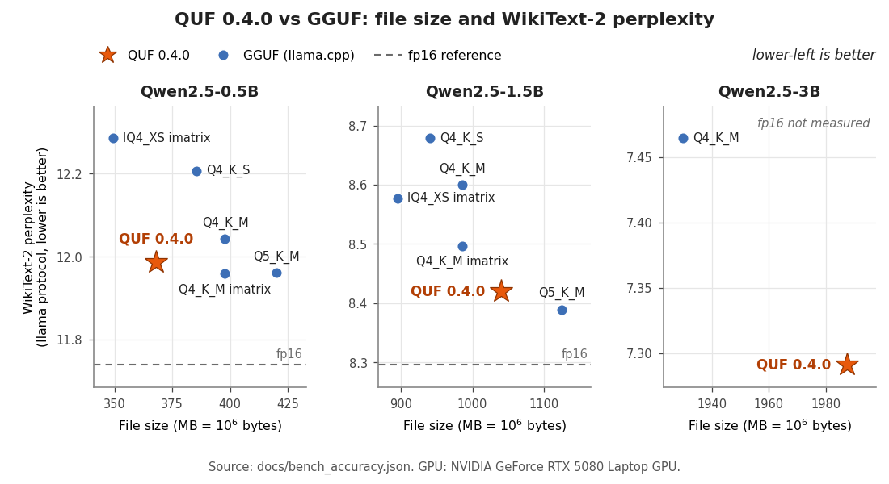

# QUF — Quantized Unified Format

QUF stores a 4-bit GPTQ-quantized LLM in one `.quf` file and runs it on NVIDIA GPUs or the CPU, natively on Windows and Linux.

[](https://pypi.org/project/quf/)
[](https://pypi.org/project/quf/)
[](https://github.com/vtrsharvin-sj/Quantized-Unified-Format/blob/main/LICENSE)
[](https://github.com/vtrsharvin-sj/Quantized-Unified-Format/actions/workflows/ci.yml)

## Why QUF

- **One self-contained file.** A `.quf` file holds the model config, the tokenizer, the quantization scheme and the weights. Tensors are 64-byte aligned and memory-mapped at load.
- **Native GPTQ** with act-order, MSE clip search and mixed int4/int8 precision. Lower WikiText-2 perplexity than llama.cpp Q4_K_M in our benchmarks on Qwen2.5 0.5B, 1.5B and 3B (the imatrix build of Q4_K_M is ahead on 0.5B).
- **Triton int4/int8 GPU kernels** with fused decode and CUDA graphs, and a CPU fallback. Faster decode than llama.cpp Q4_K_M in our benchmarks on 0.5B (662 vs 494 tok/s), and equal within noise on 1.5B (283 vs 274 tok/s) and 3B (229 vs 236 tok/s).
- **Runs natively on Windows and Linux.** No WSL. CI runs the CPU test suite on both.
- **A pure-Python package.** `pip install quf` needs no compiler; the GPU kernels are compiled by Triton at run time.

## Results at a glance

Qwen2.5 base models, one RTX 5080 Laptop GPU on Windows. All results on this page were measured with quf 0.4.0, and 0.4.1 changes no conversion output. Size and perplexity: lower is better. Decode: higher is better, measured on battery power for 0.5B and 1.5B and on AC power for 3B. Bold marks the better value per model and column; the 1.5B and 3B decode speeds are equal within noise, so neither is bold.

| Model | Format | Size MB | WikiText-2 PPL | C4 PPL | Decode tok/s |
|---|---|---:|---:|---:|---:|
| Qwen2.5-0.5B | QUF 0.4.0 | **367.9** | 11.987 | 18.777 | **662** |
| Qwen2.5-0.5B | Q4_K_M | 397.8 | 12.043 | 18.724 | 494 |
| Qwen2.5-0.5B | Q4_K_M imatrix | 397.8 | **11.959** | **18.593** | not measured |
| Qwen2.5-1.5B | QUF 0.4.0 | 1040.0 | **8.420** | 13.763 | 283 |
| Qwen2.5-1.5B | Q4_K_M | **986.0** | 8.600 | 13.954 | 274 |
| Qwen2.5-1.5B | Q4_K_M imatrix | **986.0** | 8.497 | **13.757** | not measured |
| Qwen2.5-3B | QUF 0.4.0 | 1987.4 | **7.291** | **12.154** | 229 |
| Qwen2.5-3B | Q4_K_M | **1929.9** | 7.465 | 12.311 | 236 |

QUF has a lower WikiText-2 perplexity than Q4_K_M on all three models, a lower C4 perplexity on 1.5B and 3B, and on 0.5B a 7.5% smaller file and faster decode (662 vs 494 tok/s). It has a larger file than Q4_K_M on 1.5B (+5.5%) and 3B (+3.0%), a lower decode median on 3B (229 vs 236 tok/s, within noise) and a higher C4 perplexity on 0.5B (18.777 vs 18.724). Q4_K_M imatrix (0.5B on both sets, 1.5B on C4) and Q5_K_M (0.5B and 1.5B, with larger files) are more accurate than QUF on some rows.



Every GGUF variant, the lm-eval scores and the methodology are in the Benchmarks section below. Per-axis verdicts are in the "QUF 0.4.0 vs GGUF" and "Scaling check on Qwen2.5-3B" sections of [docs/RESULTS.md](https://github.com/vtrsharvin-sj/Quantized-Unified-Format/blob/main/docs/RESULTS.md).

## Install

QUF needs Python 3.10 or newer and PyTorch.

**NVIDIA GPU.** Install a CUDA build of PyTorch first, then QUF with the Triton kernels:

```bash
pip install torch --index-url https://download.pytorch.org/whl/cu128
pip install "quf[fast]"        # or "quf[fast,convert]" to also get what quf convert needs
```

The cu128 index (CUDA 12.8) is needed for RTX 50-series GPUs, and other NVIDIA GPUs can use the same index. The order matters: an installed CUDA build of torch already satisfies QUF's torch dependency, so pip keeps it, while `pip install quf` on its own takes torch from PyPI, which is CPU-only on Windows.

**CPU only.** QUF also runs on machines with only a CPU. It then uses the `cpu` backend, and no GPU or Triton is needed:

```bash
pip install quf
pip install "quf[convert]"     # adds transformers, datasets and the rest of what quf convert needs
```

## Quickstart

Convert a Hugging Face checkpoint (about 3 minutes for 0.5B on an RTX 5080 Laptop GPU):

```bash
quf convert Qwen/Qwen2.5-0.5B qwen2.5-0.5b.quf
```

```text
quf: converting Qwen/Qwen2.5-0.5B (loading the model and calibration data, then quantizing; this can take several minutes)
Wrote qwen2.5-0.5b.quf: 367911680 bytes (0.3724 of the fp16 checkpoint size, 988065536 bytes)
Size by precision:
  int4: 195976192 bytes (115 modules: down_proj x23, gate_proj x23, up_proj x23, o_proj x23, q_proj x23)
  int8: 160611072 bytes (54 modules: embed_tokens x1, k_proj x24, v_proj x24, down_proj x1, gate_proj x1, …)
  …
```

Inspect the file:

```bash
quf info qwen2.5-0.5b.quf
```

```text
File: qwen2.5-0.5b.quf
File size: 367911680 bytes
Model config:
{
  "architecture": "Qwen2ForCausalLM",
  "hidden_size": 896,
  …
}
Quantization scheme:
{
  "act_order": true,
  "bits": 4,
  "embedding": {
    "bits": 8,
    …
  },
  "group_size": 32,
  "method": "gptq",
  …
}
Tensor count: 689
…
Triton gate: ok (triton 3.9.0)
Selected backend (auto): triton_int4
```

Generate text (greedy by default):

```bash
quf run qwen2.5-0.5b.quf --prompt "The capital of France is" --max-new-tokens 24
```

```text
quf: Selected backend triton_int4: Triton works and the int4 self-test passed; reads packed 4-bit weights
 Paris. The capital of Germany is Berlin. The capital of Italy is Rome. The capital of Spain is Madrid. The
```

Benchmark perplexity, size and speed:

```bash
quf bench qwen2.5-0.5b.quf --out results.json
```

```text
quf: Selected backend triton_int4: Triton works and the int4 self-test passed; reads packed 4-bit weights
Backend: triton_int4 (NVIDIA GeForce RTX 5080 Laptop GPU)
Perplexity scope: first 40 windows of 2048 tokens
Perplexity (wikitext-2-raw-v1): 12.4822
File size: 367911680 bytes
Tokens per second: 282.37 (median of 7, min 276.31, max 291.29)
Results written to results.json
```

`quf bench` is a quick check. It scores non-overlapping 2048-token WikiText-2 windows, 40 by default (`--max-windows 0` scores the whole test split), and times end-to-end generation of 32 tokens including prefill. The Benchmarks section uses a different perplexity protocol and steady-state decode speed, so its numbers differ from these.

## Python API

```python
import quf

with quf.load("qwen2.5-0.5b.quf") as model:
    print(model.backend)
    print(model.generate("The capital of France is", max_new_tokens=24, temperature=0))
```

```text
triton_int4
 Paris. The capital of Germany is Berlin. The capital of Italy is Rome. The capital of Spain is Madrid. The
```

Streaming: pass a callback that receives each new piece of text as it is decoded. `generate` still returns the whole text.

```python
import quf

with quf.load("qwen2.5-0.5b.quf") as model:
    text = model.generate(
        "The three primary colors are",
        max_new_tokens=24,
        stream=lambda piece: print(piece, end="", flush=True),
    )
print()
```

```text
 red, green, and blue. When these colors are mixed in various proportions, they can produce various colors. Which of
```

`quf.load(path, device="auto", backend="auto", cuda_graph=None)` takes the `quf run` values: `device` is `auto`, `cpu` or `cuda`, and `backend` is `auto`, `int4`, `cached`, `fused` or `marlin`. `cuda_graph=False` decodes eagerly. The returned `quf.Model` has `backend` (the backend in use, for example `triton_int4`), `tokenizer` and `header`. `close()`, or leaving the `with` block, releases the model.

| `generate()` parameter | Default | Meaning |
|---|---|---|
| `prompt` | required | Non-empty text. Plain completion: no chat template is applied. |
| `max_new_tokens` | `64` | At least 1. Generation also stops at the end-of-sequence token. |
| `temperature` | `0.0` | 0 is greedy decoding; above 0 samples. |
| `top_k` | `None` | At least 1 when given. |
| `top_p` | `None` | Greater than 0 and at most 1 when given. |
| `seed` | `0` | Sampling seed. |
| `stream` | `None` | Callable that receives each new text piece; the pieces join to the returned text. |

Arguments outside these limits raise `ValueError`, with the same limits as `quf run`.

## How it works

**File layout.** A `.quf` file starts with the magic `QUF1`, a uint32 format version (1, 2 or 3) and the length of a JSON header. The header holds the model config, the tokenizer files, the quantization scheme and a tensor table. Tensor data follows, each tensor at a 64-byte aligned offset, and the reader memory-maps it without copying. The byte layout is in [docs/FORMAT.md](https://github.com/vtrsharvin-sj/Quantized-Unified-Format/blob/main/docs/FORMAT.md).

**Conversion.** `quf convert` runs this pipeline with its default options:

```text
Hugging Face checkpoint (Qwen2ForCausalLM, fp16)
  -> calibration: WikiText-2 train, 128 samples x 1024 tokens
  -> GPTQ, one decoder layer at a time: act-order, MSE clip search per group
  -> size_f precision: k_proj, v_proj and the whole last layer int8, the rest int4 at group size 32
  -> embedding and tied lm_head: int8 per row, group size 64
  -> model.quf (format version 3)
```

**Runtime backends.** The default `--backend auto` picks one backend at load and logs the choice and its reason:

| Backend | Selected when | How it runs |
|---|---|---|
| `triton_int4` | An NVIDIA GPU is present, Triton imports and its int4 self-test passes | Packed int4/int8 weights read by Triton kernels |
| `torch_gpu` | GPU without working Triton, or eager decode requested, and the fp16 weights fit | Weights dequantized to fp16 at load |
| `torch_fused` | GPU, and the fp16 weights do not fit (or `--prefer-fused`) | Packed int4 weights on the GPU |
| `cpu` | No NVIDIA GPU, or `--device cpu` | PyTorch on the CPU |
| `marlin` | Only with `--backend marlin` (needs the optional gptqmodel package) | Marlin kernels |

**Fused decode.** On `triton_int4`, each decode step runs fused add+RMSNorm, RoPE with the KV-cache write, flash-decode attention and an on-device greedy argmax with a lazy end-of-sequence check. After prefill the whole step is captured once as a CUDA graph and replayed for every new token.

## Benchmarks

Qwen2.5 base models. Size is in MB of 10^6 bytes. Decode is the median tok/s of 7 rounds (0.5B, 1.5B) or 5 rounds (3B), with the min–max range in parentheses.

**Qwen2.5-0.5B** (speed on battery power)

| Format | Size MB | WikiText-2 PPL | C4 PPL | Decode tok/s |
|---|---:|---:|---:|---:|
| fp16 | 988.1 | 11.740 | 18.239 | not measured |
| QUF 0.4.0 | 367.9 | 11.987 | 18.777 | 662 (658–666) |
| Q4_K_M | 397.8 | 12.043 | 18.724 | 494 (459–510) |
| Q4_K_M imatrix | 397.8 | 11.959 | 18.593 | not measured |
| Q4_K_S | 385.5 | 12.207 | 19.002 | 496 (486–538) |
| IQ4_XS imatrix | 349.4 | 12.286 | 19.046 | 496 (489–523) |
| Q5_K_M | 420.1 | 11.961 | 18.505 | 506 (483–534) |

**Qwen2.5-1.5B** (speed on battery power)

| Format | Size MB | WikiText-2 PPL | C4 PPL | Decode tok/s |
|---|---:|---:|---:|---:|
| fp16 | 3087.4 | 8.296 | 13.476 | not measured |
| QUF 0.4.0 | 1040.0 | 8.420 | 13.763 | 283 (263–285) |
| Q4_K_M | 986.0 | 8.600 | 13.954 | 274 (268–279) |
| Q4_K_M imatrix | 986.0 | 8.497 | 13.757 | not measured |
| Q4_K_S | 940.3 | 8.679 | 14.075 | 282 (270–287) |
| IQ4_XS imatrix | 895.7 | 8.577 | 13.879 | 274 (270–278) |
| Q5_K_M | 1125.1 | 8.389 | 13.633 | 248 (242–251) |

**Qwen2.5-3B** (one conversion and one perplexity run per row, decode the median of 5 rounds, speed on AC power; fp16 and the other GGUF variants were not measured)

| Format | Size MB | WikiText-2 PPL | C4 PPL | Decode tok/s |
|---|---:|---:|---:|---:|
| QUF 0.4.0 | 1987.4 | 7.291 | 12.154 | 229 (219–241) |
| Q4_K_M | 1929.9 | 7.465 | 12.311 | 236 (225–244) |

**lm-evaluation-harness** (lm_eval 0.4.13, 0-shot, 500 examples per task, seed 1234). Accuracy in percent ± standard error.

| Model | Format | hellaswag acc | hellaswag acc_norm | arc_easy acc | arc_easy acc_norm |
|---|---|---:|---:|---:|---:|
| Qwen2.5-0.5B | fp16 | 41.0 ± 2.2 | 50.2 ± 2.2 | 63.6 ± 2.2 | 58.6 ± 2.2 |
| Qwen2.5-0.5B | QUF 0.4.0 | 41.6 ± 2.2 | 50.4 ± 2.2 | 63.6 ± 2.2 | 57.8 ± 2.2 |
| Qwen2.5-1.5B | fp16 | 48.6 ± 2.2 | 60.2 ± 2.2 | 75.0 ± 1.9 | 71.0 ± 2.0 |
| Qwen2.5-1.5B | QUF 0.4.0 | 47.0 ± 2.2 | 58.8 ± 2.2 | 74.0 ± 2.0 | 73.0 ± 2.0 |
| both | Q4_K_M | not run | not run | not run | not run |

Q4_K_M was not run because the gguf backend of lm_eval 0.4.13 needs the log-probabilities of the prompt tokens (`echo=true`), and the local llama-server build returns only those of the generated tokens, so it cannot score the answer choices.

**Methodology**

- Perplexity uses the llama protocol: 2048-token windows, scoring the second half of each window, as `llama-perplexity` does. Both sets are scored in full: the WikiText-2 test split and a held-out slice of the C4 English validation split that no calibration used. The GGUF rows come from `llama-perplexity` on the GPU (`-ngl 99`) over the same text.
- QUF calibrates on WikiText-2 train, 128 samples of 1024 tokens. The imatrix variants were built from the same calibration text (`llama-imatrix -c 1024 --chunks 128`).
- The llama.cpp b12567 CUDA build scored the GGUF rows and built the imatrix, Q4_K_S, IQ4_XS and Q5_K_M files. The 3B Q4_K_M file was made with b6100 (`convert_hf_to_gguf.py` to f16, then `llama-quantize Q4_K_M`, no imatrix).
- Decode speed compares QUF steady-state tok/s (`triton_int4`, CUDA graph, 128 new tokens, prompt "The quick brown fox", no prefill and no graph capture) with `llama-bench` tg128 (`-p 0 -n 128 -ngl 99 -r 1`), with QUF and GGUF rows interleaved in the same session. The 0.5B and 1.5B rows shared one session (2 warm-up and 7 measured rounds, rotated order), and 3B had its own (1 warm-up and 5 measured rounds). A result counts as faster or slower only when the min–max ranges do not overlap; otherwise it is equal within noise.
- End-to-end QUF medians, including prefill and graph capture, are lower: 371 tok/s on 0.5B, 200 on 1.5B and 191 on 3B. This is closer to what `quf run` and `quf bench` time.
- Hardware: NVIDIA GeForce RTX 5080 Laptop GPU, Windows 11, PyTorch 2.11.0+cu128. The 0.5B and 1.5B speed rows were measured on battery power with power-throttled clocks, and the 3B speed rows on AC power, so the two sessions are not comparable with each other.

**Reproduce.** The scripts are in [scripts/](https://github.com/vtrsharvin-sj/Quantized-Unified-Format/tree/main/scripts) and write their results into [docs/bench_accuracy.json](https://github.com/vtrsharvin-sj/Quantized-Unified-Format/blob/main/docs/bench_accuracy.json). They expect a local llama.cpp build and the model files under `eval_cache/`.

| Result | Script |
|---|---|
| fp16 perplexity rows | `scripts/bench_accuracy.py` |
| GGUF variants and imatrix files | `scripts/make_gguf_variants.py` |
| QUF and GGUF perplexity (0.5B, 1.5B) | `scripts/pareto040.py` |
| Decode speed session (0.5B, 1.5B) | `scripts/bench_final040.py` |
| lm-eval scores | `scripts/run_lmeval.py` |
| Chart | `scripts/make_readme_chart.py` |

The 3B scaling run was driven by a script that is not in the repository. Its results are stored under `scaling_3b` in the same JSON file.

## CLI reference

`quf --help` lists the commands `info`, `convert`, `run` and `bench`, and `quf --version` prints the version. Every command accepts `--verbose`, which shows library warnings, debug messages and error details.

**`quf convert SOURCE OUTPUT`** quantizes a Hugging Face model id or local directory into a `.quf` file. It needs `pip install "quf[convert]"`.

| Option | Default | Meaning |
|---|---|---|
| `--dataset DATASET` | WikiText-2 train | Calibration data: a text file, a wikitext config or a Hugging Face dataset id |
| `--samples N` | 128 | Number of calibration samples |
| `--seq-len N` | 1024 | Calibration sequence length (512 with `--legacy-calibration`) |
| `--legacy-calibration` | off | WikiText-2 only, 128 samples of 512 tokens |
| `--multi-source-calibration` | off | WikiText-2 train and English C4, 50/50, 128 x 2048 tokens |
| `--seed N` | 0 | Calibration shuffle seed |
| `--group-size {32,64,128}` | 32 | int4 group size |
| `--act-order` / `--no-act-order` | on | Quantize columns by descending Hessian diagonal (writes `g_idx`) |
| `--clip-search` / `--no-clip-search` | on | MSE-optimal clipping ratio per group |
| `--preset NAME` | `size_f` | Precision preset, see below |
| `--mixed PATTERN=PRECISION` | none | int4, int8 or fp16 for modules matching a glob, for example `"*.down_proj=int8"`; repeatable, last match wins |
| `--int8-modules PATTERN` | none | Shortcut for `--mixed "PATTERN=int8"` |
| `--embed-precision {fp16,int8,int4}` | int8 | Storage of the embedding table and an untied `lm_head` |
| `--embed-group-size {32,64}` | 64 | Group size of a quantized embedding |
| `--embed-method {clip,rtn}` | clip | Rounding of a quantized embedding |
| `--overwrite` | off | Replace an existing output file |

Presets (the default applies when no `--preset`, `--mixed` or `--int8-modules` is given):

| Preset | int8 modules (everything else int4) |
|---|---|
| `size_f` (default) | `k_proj`, `v_proj` and the whole last layer |
| `size_b` | the last layer (the 0.3.0 default body) |
| `sensitive` | every `down_proj` and the last layer (the 0.2.0 default) |
| `none` | none: every quantized module is int4 |
| `down_proj` | every `down_proj` |
| `size_a` | every `down_proj`, with the last layer int4 |
| `size_c` | none (all int4 by plan) |
| `size_d` | every attention projection and the last layer |
| `size_e` | `size_d` plus `down_proj` in the last quarter of the layers |
| `size_g` | `size_f` plus `o_proj` |

A quantized embedding (`int8` or `int4`) makes the file format version 3, and `--embed-precision fp16` writes a version 1 or 2 file that older readers open. The format records only `rtn` or `gptq` as an embedding method, so `--embed-method clip` is stored in the header as `"method": "rtn"` plus `"clip_search": true`: round-to-nearest with a clip-searched scale per group. `quf info` shows it as "rtn + clip search".

**`quf run PATH --prompt TEXT`** generates text.

| Option | Default | Meaning |
|---|---|---|
| `--max-new-tokens N` | 64 | Maximum number of new tokens |
| `--temperature T` | 0 | 0 is greedy decoding |
| `--top-k K`, `--top-p P` | off | Sampling cutoffs |
| `--seed N` | 0 | Sampling seed |
| `--no-stream` | off | Print the text at the end instead of streaming it |
| `--no-cuda-graph` | off | Decode eagerly instead of replaying a CUDA graph |
| `--device {auto,cpu,cuda}` | auto | Device to run on |
| `--backend {auto,cached,fused,marlin,int4}` | auto | `int4` is `triton_int4`, `cached` is `torch_gpu`, `fused` is `torch_fused`, `marlin` needs gptqmodel |
| `--prefer-fused` | off | In auto mode, use the fused backend |

**`quf bench PATH --out FILE`** writes perplexity, file size and tokens per second to a JSON file. It accepts `--device` and `--backend` as `quf run` does, `--prefer-fused`, `--max-windows N` (default 40, 0 for the whole WikiText-2 test split), `--fp16-ref MODEL` for an fp16 reference perplexity, and `--gguf FILE` for a GGUF comparison.

**`quf info PATH`** prints the model config, the quantization scheme, the tensor count, the size by precision, the Triton check and the backend that `auto` would select.

Environment variables (set to `1`):

| Variable | Effect |
|---|---|
| `QUF_NO_TRITON` | Never import Triton; on a GPU, `auto` uses `torch_gpu` or `torch_fused` |
| `QUF_NO_CUDA_GRAPH` | Decode eagerly, like `--no-cuda-graph`; `auto` then prefers `torch_gpu` |
| `QUF_NO_FUSED` | Keep `triton_int4` but turn off the fused decode kernels |

## Supported models

QUF supports the Qwen2 architecture, `Qwen2ForCausalLM`. It is tested on Qwen2.5-0.5B, Qwen2.5-1.5B and Qwen2.5-3B. The Instruct variants share the architecture, but `quf run` and `generate()` do plain completion and apply no chat template. `quf convert` rejects every other architecture, Qwen3 included, before it loads any weights:

```text
quf: error: Unsupported model architecture 'Qwen3ForCausalLM'. Supported: Qwen2ForCausalLM.
```

## Limitations

- One architecture: Qwen2 (`Qwen2ForCausalLM`).
- The runtime targets batch-1 decoding. There is no server and no batching.
- No chat template: prompts are completed as plain text.
- The fast GPU path needs an NVIDIA GPU and Triton. Other GPUs use the `cpu` backend.
- A file uses one int4 group size (32 by default) and keeps some modules at int8, which is why the 1.5B and 3B files are larger than Q4_K_M.
- QUF has a higher C4 perplexity than Q4_K_M on 0.5B (18.777 vs 18.724). Its 3B decode median is lower than Q4_K_M's (229 vs 236 tok/s), within noise because the ranges overlap.
- All speed numbers come from one laptop GPU, partly on battery power.
- Format version 3 files, the default, need quf 0.4.0 or later.
- The `marlin` backend is optional and has not been verified on this hardware.
- Conversion loads the fp16 model into RAM and uses the GPU when there is one. Measured on the RTX 5080 Laptop GPU: about 3, 10 and 15 minutes for 0.5B, 1.5B and 3B.

## Troubleshooting

**Triton is not available.** The `quf:` log line says `int4 unavailable`, or `--backend int4` fails with the reason. Install the extra, then check that `quf info` prints `Triton gate: ok`:

```bash
pip install "quf[fast]"
```

**No GPU is used on an NVIDIA machine.** pip may have installed a CPU-only PyTorch build. This prints a `+cpu` version and `False` in that case:

```bash
python -c "import torch; print(torch.__version__, torch.cuda.is_available())"
```

Run `pip uninstall -y torch` first, because pip keeps any installed torch, then install the CUDA build as shown under Install.

**triton-windows in a `--system-site-packages` venv.** When triton-windows is installed only in the base Python, it looks for its bundled C compiler and CUDA files in the venv and fails with `Failed to find C compiler`, so `auto` falls back to `torch_gpu`. Create the venv without `--system-site-packages`, or install triton-windows inside the venv with the version that the base Python has. `pip show` run by the base interpreter prints that version:

```powershell
deactivate                                 # leave the venv, so python is the base Python
python -m pip show triton-windows          # note the Version line, for example 3.9.0.post30
.venv\Scripts\Activate.ps1                 # back into the venv (your venv's path)
python -m pip install --ignore-installed --no-deps triton-windows==3.9.0.post30   # that version
```

**Turning off the fast paths.** `--backend cached` uses `torch_gpu`, and `--no-cuda-graph` decodes eagerly. The environment variables in the CLI reference do the same for every command and for the Python API (in PowerShell, `$env:QUF_NO_FUSED = "1"`; QUF_NO_TRITON and QUF_NO_CUDA_GRAPH work the same way):

```bash
QUF_NO_FUSED=1 quf run qwen2.5-0.5b.quf --prompt "Hello"
```

**`unsupported version` error.** The file uses a newer format version than the installed quf reads. Version 3 files need quf 0.4.0 or later: `pip install -U quf`. To make a file for an older reader, convert with `--embed-precision fp16`.

**GPU out of memory.** `quf run` exits with status 1 and a GPU memory error. Close other GPU programs, keep `--backend auto` (`triton_int4` and `torch_fused` keep the weights packed, while `--backend cached` holds fp16 copies), or use `--device cpu`.

## File format

| Version | Adds | First quf release that reads it |
|---|---|---|
| 1 | int4 GPTQ weights with group size 128, config and tokenizer in the header | 0.1.0 |
| 2 | Group sizes 32 and 64, act-order `g_idx` tensors, per-module int8 and fp16 | 0.2.0 |
| 3 | Quantized embedding and `lm_head` (int8 or int4 per row) | 0.4.0 |

The writer picks the lowest version that holds the features a file uses. A reader rejects a version that is higher than it supports. The full specification is [docs/FORMAT.md](https://github.com/vtrsharvin-sj/Quantized-Unified-Format/blob/main/docs/FORMAT.md).

## Development

```bash
git clone https://github.com/vtrsharvin-sj/Quantized-Unified-Format.git
cd Quantized-Unified-Format
pip install -e ".[test,fast,convert]"
python -m pytest -m "not gpu and not convert" -q
```

The last command is the CPU suite that CI runs on Python 3.10 to 3.13 on ubuntu-latest and windows-latest. `python -m pytest -q` runs everything. Test markers:

| Marker | Needs |
|---|---|
| `gpu` | An NVIDIA GPU (skipped when none is available) |
| `triton` | A working Triton (skipped when unavailable) |
| `realmodel` | A real converted model file (skipped when missing) |
| `convert` | The convert extra and a real model download and conversion |

## Changelog

Release history: 0.1.0 introduced the format, 0.2.0 GPTQ act-order, clip search and mixed precision, 0.2.1 CUDA graph decoding, 0.3.0 the Triton int4 backend, 0.4.0 the int8 embedding (format version 3), the `size_f` default and the fused decode kernels, and 0.4.1 the `quf.load` Python API; details per release are in [CHANGELOG.md](https://github.com/vtrsharvin-sj/Quantized-Unified-Format/blob/main/CHANGELOG.md).

## License

QUF is released under the MIT license. See [LICENSE](https://github.com/vtrsharvin-sj/Quantized-Unified-Format/blob/main/LICENSE).

## Acknowledgements

- GPTQ: Elias Frantar, Saleh Ashkboos, Torsten Hoefler and Dan Alistarh, [GPTQ: Accurate Post-Training Quantization for Generative Pre-trained Transformers](https://arxiv.org/abs/2210.17323) (2022).
- [llama.cpp](https://github.com/ggml-org/llama.cpp) and [ggml](https://github.com/ggml-org/ggml): the comparison baseline, and the tools (`llama-quantize`, `llama-imatrix`, `llama-perplexity`, `llama-bench`) that produced the GGUF rows.
- [Triton](https://github.com/triton-lang/triton) and [triton-windows](https://github.com/woct0rdho/triton-windows), which compile the GPU kernels.
- [gigatoken](https://github.com/marcelroed/gigatoken) for fast tokenization of the calibration and evaluation text.
- The [Qwen team](https://huggingface.co/Qwen) for the Qwen2.5 models.
- Hugging Face [transformers](https://github.com/huggingface/transformers) and [datasets](https://github.com/huggingface/datasets).
